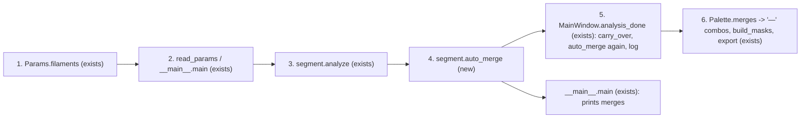

# Automatic merge by distance (Filamentos)

**Approved**: 2026-11-22 - user: "approve"
**Settled mid-build:** after the review, on keeping Filamentos = 1 (merge everything into one) and writing "1 filamento" in the singular - user: "1"
**Review:** sent at e5c1d9e
**Fix pass:** done - findings 1-3: tests that fail under a Ward cost, under a fixed distance basis (always centers or always samples) and under another tie-break; finding 5: moved the `why:` comment to its line; finding 4 (Filamentos = 1 and the singular "1 filamentos") is a product decision, taken to the user; the watertight export failure on the sample image is pre-existing

## Problem

"Nº de cores" is both the number of tones k-means looks for and the number of filaments the
model ends up with. With a small k, k-means fuses tones that are clearly distinct. With a large k,
the user gets more parts than they have filaments and has to merge them one at a time with the "—"
combo, picking by eye which ones are close. Evidence: `.specs/melhorias-cores.md` §4 and its
Diagnosis. On `workdir/cha-bebe/Gemini_Generated_Image_yah5wqyah5wqyah5.png` (target "2 verdes,
1 rosa e 1 branco"), k=4 gives `(92,90,55) 14%`, `(222,142,148) 11%`, `(171,171,107) 30%`,
`(215,213,179) 46%`. The two pinks of the butterfly fuse, the cream belly falls into the sage
background, and the dino's spots and the leaf outlines become one dark green. Measured
2026-11-22 (k=8, color background): repeatedly merging the two closest LAB centers down to 4 gives
`{#514F28, #62613F, #2F2D1D} 11%`, `{#CC858A, #E5B0B0} 11%`, `{#ABAB6C, #818257} 33%`,
`{#D7D5B3} 45%`. That is two greens, one pink and one cream.

When this ships, the user keeps "Nº de cores" as the number of tones detected and sets
"Filamentos" to how many filaments they have. The closest tones are then merged automatically
until that many remain, and the result shows in the existing "—" combos, where the user can still
correct it by hand. With "Filamentos" at 0 ("desligado"), the output is identical to today.

## Shape

This reuses `Palette.merges`, `Palette.resolve`/`active` and the "—" combos: auto-merge only
fills `merges`, and `build_masks`, export, preview, 3D and percentages read it as they read a
manual merge today. The merge rule (distance, survivor, edited rows, base, stop condition) lives in
`img2bambu/segment.py`, where `tests/test_core.py` reaches it. The GUI field is covered in
`tests/test_gui_palette.py` and the CLI flag in `tests/test_core.py`.

1. user sets "Filamentos" (GUI spin box) or `--filaments N` (CLI) -> `Params.filaments` (exists, new field)
2. `MainWindow.read_params` / `__main__.main` (exists) - hand `Params` to `segment.analyze`
3. `segment.analyze` (exists) - after k-means, calls the auto-merge rule on the fresh palette
4. `segment.auto_merge` (new) - with the CIELAB of each row (k-means center, or its `samples` once any is edited) and its share of pixels from
   `assign`, repeatedly merges the closest pair of groups until `filaments` groups remain. Edited
   rows never become the merged-away side. `base_index` follows `resolve`. Writes `Palette.merges`
   and returns how many groups remain
5. GUI `MainWindow.analysis_done` (exists) - after `carry_over` (which may mark rows edited), runs
   `auto_merge` again on the carried-over palette, logs the result line, rebuilds rows
6. out: `Palette.merges` -> "—" combos (`ColorRow.refresh`, exists), `build_masks`/export/preview/3D (exist)

**Merge rule (step 4)**

- Groups start as the rows of the palette (manual merges from before are discarded, as a
  re-analysis does today).
- Distance between two groups = Euclidean distance between their centroids in LAB. A group's
  centroid = the pixel-share-weighted mean of its rows' sample LAB (a group of one row = that
  row's sample).
- Each step merges the pair with the smallest distance among the pairs where at least one group
  holds no edited row. The survivor is the group with the larger pixel share, and the one with an
  edited row when there is one. Every row of the merged-away group points to the survivor's head row.
- It stops when `filaments` groups remain, or when no allowed pair is left.

**Changes underneath**

| Front | What changes |
| --- | --- |
| domain | `Palette.merges` was filled only by the user, now `analyze` and `analysis_done` can fill it. `ColorRow.refresh`, `set_merge`, `build_masks` and `active()` read it and already handle any acyclic map |
| domain | `Palette.base_index` can come out of `analyze` already resolved to a survivor. Today `suggest_base` picks it, and `set_merge` moves it the same way |
| domain | `Analysis.base` (new field) keeps the suggested base before any merge, so `auto_merge` can run again after `carry_over` from the same starting point |
| stored data | nothing - `Params` and `Palette` live in memory only, and `Filamentos` is not saved in `QSettings` |
| readers | "—" combos, percentages, Cores (prévia), 3D tab, export/STLs, the >4-parts warning, and the CLI's `Paleta:` output |

Data: none - nothing is persisted.

## Surface

None - nothing consumed outside over HTTP. The one external signature that changes is the CLI (anyone may call it):
`python -m img2bambu image --filaments N`, where `N` is an integer 0–8 and defaults to 0. With
N ≥ 1, after the `Paleta:` line it prints `Mesclagem automática: <k> cores → <m> filamentos.` and
one line per merged row: `Mesclada: #RRGGBB → #RRGGBB`. Exit code 0 on success. Exit code 2
(argparse error) when N is out of range or not an integer.

## Landing

None - no persisted schema, no new dependency (pure numpy), and the CLI flag is additive with a
default that keeps today's behaviour.

- Nothing else in this change is hard to reverse

## Criteria

### S1: Filamentos in the GUI merges the closest tones (P1)

The user sets "Filamentos" and sees the closest colors already merged in the "—" combos and the preview.

**Acceptance Criteria**

1. The system SHALL have `Params.filaments`, an integer with default 0.
2. WHILE `filaments == 0` the system SHALL produce an `Analysis` whose palette has empty `merges` and
   the same `base_index`, `colors`, `samples` and `labels` as today for the same image and params
3. IF `filaments >= ` the number of rows THEN `segment.analyze` SHALL leave `merges` empty
   - 8 rows, filaments 8 → no merges; filaments 9 (via API) → no merges; filaments 7 → exactly 1 merge
4. WHEN `filaments = m` with 1 ≤ m < rows and no edited rows THEN `segment.analyze` SHALL leave exactly
   `m` labels in `palette.active()`
5. Each step SHALL merge the pair of groups with the smallest LAB distance between centroids, where
   a centroid is the pixel-share-weighted mean of its rows' sample LAB
   - synthetic image with 3 well-separated tones A (40%), A′ (ΔE ≈ 5 from A, 10%), B (50%), k=3,
     filaments 2 → A′ merges into A; B stays. The strong case: a 2% tone far from all others survives
     while two 30% tones close to each other merge. Area does not make a small distinct color go first
6. WHEN two groups merge THEN the group with the larger pixel share SHALL survive (its head row keeps
   its filament color and stays active), and the other group's rows SHALL point to it in `merges`
   - A 40% vs A′ 10% → `merges[A′] == A`; equal shares → the lower label survives
7. IF the base row is merged away THEN `palette.base_index` SHALL be the survivor's label
   (`resolve(base_index)`), and the base SHALL be one of the `active()` labels
8. The resulting `merges` SHALL be acyclic: `resolve(i)` SHALL end on an active label for every row
9. The system SHALL run the same steps the same way on every run: same image and params → same `merges`
10. The GUI SHALL show a "Filamentos:" spin box in the "2. Cores" group right below "Nº de cores",
    range 0–8, step 1, default 0, with 0 shown as "desligado", tooltip
    "Quantos filamentos usar: as cores mais parecidas são mescladas até sobrar esse número (desligado = não mesclar)"
11. WHEN the user changes "Filamentos" with an image loaded THEN the system SHALL re-analyze (status
    "Detectando cores…") with the new value, as a change of "Nº de cores" does, and the "—" combo of
    each merged-away row SHALL show `→ #RRGGBB` of its target
12. WHEN an analysis ends with at least one automatic merge THEN the GUI SHALL log
    `Mesclagem automática: <k> cores → <m> filamentos.` where k = rows and m = active labels
    - k=8, filaments 4 → "Mesclagem automática: 8 cores → 4 filamentos."; filaments 0 → no line;
      filaments 1 → "Mesclagem automática: 8 cores → 1 filamento." (singular, settled mid-build)
13. WHEN the user changes a "—" combo after an automatic merge THEN the system SHALL apply that manual
    merge (or un-merge) as today, and it SHALL stand until the next re-analysis
14. WHEN the user edits a sample or filament (dialog or eyedropper) THEN the system SHALL NOT recompute
    the automatic merges
15. WHEN the user changes "Filamentos" with no image loaded THEN the system SHALL do nothing (no analysis, no error)

### S2: Edited rows are never merged away (P1)

With the fixed palette, the rows the user tuned keep their own filament.

**Acceptance Criteria**

16. WHEN a re-analysis carries edited rows over (`carry_over`) THEN the GUI SHALL recompute the
    automatic merges on the carried-over palette, with its edited samples
17. The system SHALL never merge away a group that holds an edited row: an edited row's label SHALL
    stay in `active()`. A group with an edited row MAY absorb others, and the survivor of such a merge
    SHALL be the group with the edited row
    - edited row X, 5% share, closest to an unedited 40% row Y → `merges[Y] == X`, X active
18. IF the closest pair is two groups that both hold edited rows THEN the system SHALL skip that pair
    and merge the next closest allowed pair
19. IF the allowed pairs run out before `filaments` groups remain THEN the system SHALL stop with the
    merges made so far, and the GUI SHALL log
    `Mesclagem automática: só foi possível chegar a <m> filamentos (<e> cores editadas).`
    - 8 rows, 5 edited, filaments 4 → 5 active (the 5 edited), log names 5 and 5

### S3: `--filaments` on the CLI (P2)

The CLI accepts the same target and prints what it merged.

**Acceptance Criteria**

20. WHEN the CLI runs with `--filaments N` (0 ≤ N ≤ 8) THEN the system SHALL analyze with
    `Params.filaments = N` and export with the resulting merges; without the flag it SHALL use 0
21. WHEN the CLI analysis made at least one merge THEN it SHALL print, after the `Paleta:` line,
    `Mesclagem automática: <k> cores → <m> filamentos.` and one `Mesclada: #RRGGBB → #RRGGBB` line
    per merged-away row (its filament color → the color of the row it resolves to)
22. IF `--filaments` is outside 0–8 or not an integer THEN the CLI SHALL exit with code 2 and an
    argparse error naming `--filaments`, before reading the image
    - `--filaments 9` → exit 2; `--filaments -1` → exit 2; `--filaments 8` → accepted

## Out of scope

| Excluded | Why |
| --- | --- |
| Area-weighted (Ward) criterion | user chose distance only. Measured: it folds the 1% dark outline into the dark green |
| Re-merging after each sample/filament edit | user chose: auto-merge runs only on (re)analysis |
| Persisting "Filamentos" | user chose no, like Nº de cores and Suavização |
| Raising the default of "Nº de cores" or defaulting "Filamentos" to 4 | user chose default off, identical to today |
| Recomputing the survivor's filament color from the merged pixels | manual merge keeps the target's color today, so auto-merge does the same |
| Protecting the base row from being merged away | user chose that the base may merge and moves to the survivor |

## Assumptions

| Assumption | Chosen default | Rationale | Confirmed? |
| --- | --- | --- | --- |
| Control | new "Filamentos" spin 0–8, 0 = "desligado" (default), below "Nº de cores" | user chose it | y |
| Criterion | LAB distance between pixel-share-weighted centroids | user chose distance only | y |
| Survivor | larger pixel share; base may be merged and follows `resolve` | user chose it | y |
| Edited rows | never merged away, may absorb; stop early + message when not enough allowed pairs | user chose it | y |
| When it runs | only on (re)analysis; manual "—" stands until next re-analysis | user chose it | y |
| CLI | `--filaments N` 0–8, default 0, prints merges | user chose it | y |
| Feedback | existing combos + log line `Mesclagem automática: <k> cores → <m> filamentos.` | user chose it | y |
| Persistence | not saved | user chose it | y |
| `Filamentos = 1` | allowed: everything merges into one group (single base, no raised parts), like merging all by hand today | the spin is 0–8 and an all-merged model already works (`test_model_all_merged_is_base_only`) | y |
| Distance basis | CIELAB (OpenCV's 8-bit L rescaled ×100/255) of the exact k-means centers while no sample is edited, else of each row's `samples` ("cor na imagem"); share from `assign` | same basis `assign` uses to give pixels to rows. On the sample image the 4th merge is a near-tie (ΔE ≈ 21 both ways) that the RGB round trip of `samples` flips; found mid-build | n |
| Tie-breaks | equal distance → the pair with the lower (smaller, then larger) labels; equal share → lower label survives | determinism (criterion 9) | n |
| Stop-early message text | `Mesclagem automática: só foi possível chegar a <m> filamentos (<e> cores editadas).` | Portuguese, same prefix as the success line | n |
| CLI merge lines | `Mesclada: #RRGGBB → #RRGGBB` (filament colors) | the user asked that the CLI print the merges, and the format was left open | n |

**Open questions:** none - all resolved or logged above.

## Differences from the source

None - the product matches the source

## Sources

- `.specs/melhorias-cores.md` §4 - binding - scope: detect more colors and merge the closest in LAB down to the filament count, manual merge still corrects; points to decide answered above
- `workdir/cha-bebe/Gemini_Generated_Image_yah5wqyah5wqyah5.png` - non-binding - measurement only (Problem)
