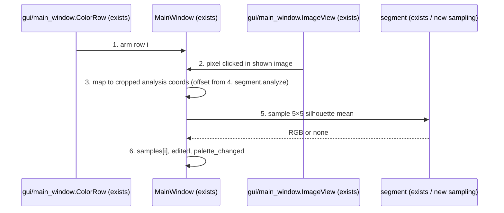

# Eyedropper (conta-gotas)

**Approved**: 2026-11-22 - user: "plano aprovado"
**Settled mid-build:** none
**Review:** sent at 9a58378
**Fix pass:** done - finding 1: preview_done keeps the armed-pick hint instead of "Prévia pronta…"; finding 2: clicks outside the shown image (Original: loaded image, Prévia: preview pixmap) are rejected with "Clique dentro do objeto." before sampling; finding 3: tests for unarmed drag-pans + double-click-fit (criterion 8) and floor-not-round preview mapping (criterion 11); finding 4: the new eyedropper test uses a temp QSettings (pre-existing `test_new_image_starts_fresh` still writes `dir`, left as is - outside this feature); minor notes (double-click while armed refits, .5 rounding to even, pick armed during a pending analysis) left as is

## Problem

The only way to set a row's "cor na imagem" is to type or pick an RGB value in Qt's color dialog.
The user knows *where* the tone they want is in the image (the second pink of the butterfly, the
dino's cream belly), but not its RGB value, so they guess, look at the result, and guess again.
"Pick Screen Color" in the dialog samples the *screen*: on the *Cores (prévia)* tab that is the
filament color, not the image's. It also samples a single scaled, smoothed screen pixel. Evidence:
`.specs/melhorias-cores.md` §2 ("o usuário aponta o tom que quer em cada filamento, sem adivinhar
RGB"). The source gives no measurement.

When this ships, the user clicks a row's eyedropper button and then a point on the *Original* or
*Cores (prévia)* tab. That row's "cor na imagem" becomes the image's color at that point, and the
preview re-separates exactly as if they had picked the color in the dialog.

## Shape

This reuses the "cor na imagem" edit path from fixed-palette: `Palette.samples`, `Palette.edited`
and `MainWindow.palette_changed`. Assignment, carry-over, preview and export stay unchanged. The
sampling rule (5×5 window, silhouette pixels only, mean, outside → nothing) lives in
`img2bambu/segment.py`, where `tests/test_core.py` covers it. The GUI maps the click to image
coordinates and calls it, and `tests/test_gui_palette.py` covers that.

1. user clicks the eyedropper button of row *i* -> `gui/main_window.ColorRow` (exists) - arms the
   pick for row *i* on `MainWindow`; the two `ImageView`s show a cross cursor
2. user clicks a point -> `gui/main_window.ImageView` (exists) - turns the press into a pixel of the
   shown image and hands it to `MainWindow`
3. `MainWindow` (exists) - turns the pixel into coordinates of the cropped analysis image: Original
   tab subtracts the crop offset; preview tab divides by `upsample`
4. `segment.analyze` (exists) - also records the crop offset on `Analysis`
5. `segment` sampling (new) - mean RGB of the silhouette pixels in the 5×5 window, or none
6. `MainWindow` (exists) - writes `palette.samples[i]`, adds *i* to `palette.edited`, disarms,
   calls `palette_changed` (exists) → percentages + debounced preview, as a dialog pick does

**Changes underneath**

| Front | What changes |
| --- | --- |
| domain | `Analysis` gains the crop offset (y0, x0) of the cropped image inside the loaded image; nothing branches on it today |
| stored data | nothing - in memory only |
| readers | preview tab, percentages, 3D tab, export - through the existing `palette_changed` path |

Data: none - nothing is persisted.

## Surface

None - nothing consumed outside (CLI unchanged).

## Landing

None - no persisted schema, no new dependency, no external contract; `Analysis` is an in-memory
dataclass.

- Nothing else in this change is hard to reverse

## Criteria

### S1: eyedropper on the Original tab (P1)

The user arms a row and clicks the Original tab. The row's "cor na imagem" becomes the sampled
color and the preview re-separates.

**Acceptance Criteria**

1. WHEN an analysis completes THEN each color row SHALL show an eyedropper button beside the "cor na
   imagem" swatch, with tooltip "Conta-gotas: clique e depois clique na imagem (Original ou
   Prévia) para definir a cor na imagem (Esc cancela)"
2. WHEN the user clicks row *i*'s eyedropper button THEN the system SHALL arm the pick for row *i*.
   Both image tabs SHALL show a cross cursor and the status bar SHALL read "Clique na imagem para
   definir a cor na imagem da cor N (Esc cancela)." with N = *i*+1
3. WHILE a pick is armed, WHEN the user left-clicks the Original tab THEN the system SHALL set row *i*'s "cor na imagem" to the mean RGB (rounded to int) of the silhouette pixels in
   the 5×5 window centred on the clicked image pixel, clipped to the image. It SHALL mark row *i*
   edited, disarm, and re-render the preview with the new percentages, as criterion 4 of
   fixed-palette does for the dialog
   - click at the centre of a uniform PATCH area `(180,178,120)` → sample `(180,178,120)`
   - click on a pixel whose window has 10 sage `(215,213,179)` and 15 green `(171,171,107)`
     silhouette pixels (sage|green boundary at x=200, click x=200) → `(189,188,136)`
   - click 1 px inside the silhouette edge, window part background → mean of the silhouette pixels
     only, background ignored
4. IF the 5×5 window holds no silhouette pixel THEN the palette SHALL not change (click on the
   background, or outside the image), the pick SHALL stay armed, and the status bar SHALL read
   "Clique dentro do objeto."
5. WHILE a pick is armed, WHEN the user presses Esc THEN the system SHALL disarm with the palette
   unchanged, restore the cursors, and the status bar SHALL read "Conta-gotas cancelado."
6. WHILE a pick is armed for row *i*, WHEN row *i*'s button is clicked THEN the system SHALL disarm as in criterion 5. WHEN they click row *j*'s button THEN the pick SHALL
   move to row *j*
7. WHILE a pick is armed, a left-button press SHALL not start a pan drag. Wheel zoom SHALL keep
   working
8. WHEN no pick is armed THEN clicking, dragging and double-clicking the image tabs SHALL behave as
   today (pan, fit)
9. WHEN a reanalysis rebuilds the rows or another image is opened THEN an armed pick SHALL be
   disarmed with the palette unchanged
10. The system SHALL apply every fixed-palette rule of an edited row to a sampled "cor na imagem": assignment,
    carry-over on reanalysis, and the filament color left unchanged

### S2: eyedropper on the Cores (prévia) tab (P2)

The same pick works on the preview. It samples the original image, not the filament color shown.

**Acceptance Criteria**

11. WHILE a pick is armed, WHEN the user left-clicks the preview THEN the system SHALL sample
    (on the Cores (prévia) tab, preview pixel (py, px)) as in criterion 3 at analysis pixel
    (py // upsample, px // upsample) of the cropped image. The result SHALL equal what a click on the
    same image point in the Original tab gives
    - PATCH area whose filament was changed to `#FF0000` → sample `(180,178,120)`, not red
12. IF the preview click maps to a window with no silhouette pixel THEN criterion 4 SHALL apply
13. WHILE a pick is armed, a click on the 3D tab SHALL do nothing and the pick SHALL stay armed

## Out of scope

| Excluded | Why |
| --- | --- |
| Creating a new color row from a click | user's answer: "Não, fora do escopo"; a row outside k-means would be dropped on reanalysis and desync "Nº de cores" |
| Popup menu "usar como cor na imagem de…" / selected-row mode | user chose one eyedropper button per row |
| Setting "cor do filamento" with the eyedropper | the source asks only for "cor na imagem"; the dialog still sets the filament |
| Eyedropper on the 3D tab | user chose Original and Prévia |
| Global keyboard shortcut to arm | arming is per row; Esc cancels. A shortcut would need a "current row", which the user did not choose |
| Configurable window size | fixed 5×5 by the user's answer |

## Assumptions

| Assumption | Chosen default | Rationale | Confirmed? |
| --- | --- | --- | --- |
| Which row a click sets | per-row eyedropper button, one pick per arm, Esc cancels | user's answer: "Botão por linha (Recomendado)" | y |
| Sample | mean of silhouette pixels in a 5×5 window; outside the object → nothing changes, warning | user's answer: "Média 5×5 do objeto (Recomendado)" | y |
| New color from a click | no | user's answer: "Não, fora do escopo (Recomendado)" | y |
| Tabs | Original and Cores (prévia) | user's answer: "Original e Prévia (Recomendado)" | y |
| After a click outside the object | pick stays armed so the user can retry (criterion 4) | a miss should not make the user re-arm | n |
| Pan while armed | disabled; wheel zoom still works (criterion 7) | press = sample removes click/drag ambiguity | n |
| Button look | small button with "💧" text, 24 px high like the swatches; checked state while armed | matches existing swatch buttons; no icon asset | n |
| Window on the Original tab | taken on the cropped analysis image (offset subtracted); pixels outside the crop count as background | outside the bbox there is no silhouette pixel anyway | n |
| Merged row | eyedropper still enabled; its sample still decides which pixels are then merged | samples matter before merges are applied | n |

**Open questions:** none - all resolved or logged above.

## Differences from the source

None - no binding capture; `.specs/melhorias-cores.md` §2 is the request text. Its "nova cor" and
"menu" options were declined by the user (Out of scope).

## Sources

- `.specs/melhorias-cores.md` §2 (in `request.md`) - binding as the request; the user settled its "pontos a decidir"
- `.specs/features/fixed-palette/plan.md` - the "cor na imagem" rules this feature feeds
