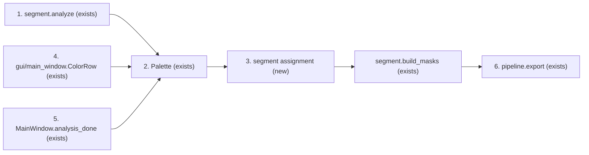

# Fixed palette (cor na imagem × cor do filamento)

**Approved**: 2026-11-22 - user: "Aprovado"
**Settled mid-build:** criterion 9 (after review finding 1: positions shift when k-means re-sorts, pink was lost at N 4→5) - user chose "Pela cor mais próxima (Recomendado)": each edited row replaces the new k-means row whose "cor na imagem" is nearest in LAB, no row reused; edited rows beyond the new N are dropped
**Review:** sent at 7ddadac
**Fix pass:** done - finding 1: carry-over now matches edited rows to the nearest new row (user decision, criterion 9 rewritten; moved to `segment.carry_over`); finding 2: filament count taken from the masks the preview built, so cleaned-away colors are not counted; finding 4: Out-of-scope reason for Bambu preset colors corrected; finding 5: test with criterion 2 example pixel added; finding 3 (0.08% boundary shift once a sample is edited) left as is - spec only requires exactness when nothing is edited

## Problem

Which pixels go to each color is decided only by k-means; the user cannot steer it. Clicking a
color swatch today changes only the filament color (preview and 3MF), never the separation. With
`workdir/cha-bebe/Gemini_Generated_Image_yah5wqyah5wqyah5.png` and 4 colors, the user wants
"2 verdes, 1 rosa e 1 branco", but k-means groups the in-between tones its own way (the dino's
cream belly lands with the pale-sage background, the two pinks of the butterfly merge, spots and
leaf outlines merge into dark olive), and the only lever is "Nº de cores" plus merging. Evidence:
the user's screenshot ("a visualização não está ficando boa") and the measured k=4 palette
`(92,90,55) 14%`, `(222,142,148) 11%`, `(171,171,107) 30%`, `(215,213,179) 46%`.

When this ships, each color row has a "cor na imagem" that the user can change to pull pixels into
or out of that color, separate from the "cor do filamento" that gets printed, and the preview
updates to show the result.

## Shape

Reuses the existing k-means analysis (it now only supplies the initial values), the `Palette`
merges/base/streak, the debounced preview and the export path unchanged. The pixel-assignment rule
(pixel → nearest "cor na imagem" in LAB) and the reanalysis carry-over rule live in
`img2bambu/segment.py` / `img2bambu/params.py`, which `tests/test_core.py` covers with pytest; the
GUI only stores edits and calls them.

1. image → `segment.analyze` (exists) - k-means as today; additionally returns each cluster's
   center as the initial "cor na imagem" of each row; the median stays the initial "cor do filamento"
2. `Palette` (exists) - gains one "cor na imagem" per row and a record of which rows the user edited
3. `segment` assignment (new) - labels every silhouette pixel with the row whose "cor na imagem" is
   nearest in LAB; feeds `segment.build_masks` (exists), so preview, 3D view and export all use it
4. `gui/main_window.ColorRow` (exists) - second swatch; either edit marks the row edited and calls
   `palette_changed` (exists), which re-renders and recomputes the percentages
5. reanalysis: `MainWindow.analysis_done` (exists) - keeps edited rows from the previous palette
   via the carry-over rule; opening a new image does not carry anything over
6. out: preview PNG, STLs and 3MF colored with "cor do filamento" (`pipeline.export`, exists)

**Changes underneath**

| Front | What changes |
| --- | --- |
| domain | `Palette.colors` stays the filament color (read by `segment.preview`, `geometry.build_parts`, `pipeline.export`, merge combo labels). `Analysis.labels` stops being the final assignment: the assignment now depends on the palette |
| stored data | nothing - the palette lives in memory only |
| readers | preview tab, 3D tab, percentages column, exported STL/3MF/preview PNG - all through the new assignment |

Data: none - nothing is persisted (palette is per-session, per-image).

## Surface

None - nothing consumed outside (CLI unchanged).

## Landing

None - no persisted schema, no new dependency, no external contract; `Palette` is an in-memory
dataclass.

- Nothing else in this change is hard to reverse

## Criteria

### S1: editing "cor na imagem" re-separates the image (P1)

The user changes a row's "cor na imagem" and watches pixels move between colors in the preview,
while the printed color stays the "cor do filamento".

**Acceptance Criteria**

1. WHEN an analysis completes THEN each color row SHALL show two swatches: "cor na imagem",
   initialized to the k-means cluster center, and "cor do filamento", initialized to the cluster's
   median color (today's value)
2. The system SHALL assign every silhouette pixel to the row whose "cor na imagem" has the smallest
   Euclidean distance in OpenCV LAB, over all rows; merges then apply on top as today; a tie goes
   to the lower row index
   - samples `(215,213,179)` and `(171,171,107)`, pixel `(214,212,178)` → first row; same, with the
     first row's filament changed to `#FFFFFF` → still first row, drawn white
   - two rows with the same "cor na imagem" → every such pixel goes to the lower index; the other
     row gets 0%
3. IF no "cor na imagem" has been edited THEN the assignment SHALL equal the labels k-means produces
   today, pixel for pixel
4. WHEN the user confirms a color in the "Cor na imagem" dialog THEN the preview SHALL re-render
   with the pixels reassigned and the row percentages SHALL show the new shares (the dialog opens
   from the "cor na imagem" swatch)
5. WHEN the user confirms a color in the "Cor do filamento" dialog THEN the preview SHALL redraw
   that row's areas in the new color, and the assignment and percentages SHALL stay unchanged (the
   dialog opens from the "cor do filamento" swatch)
6. IF the user cancels either dialog THEN nothing SHALL change
7. WHEN a project is exported THEN the system SHALL color the STL parts, `filament_colour` in the
   3MF and the preview PNG with "cor do filamento", never "cor na imagem"
8. IF an edit leaves a non-base row with 0 pixels THEN that row SHALL show "0%" and
   "N filamento(s) no projeto." SHALL not count it, matching the parts export produces

### S2: reanalysis keeps what the user adjusted (P2)

Changing "Nº de cores", "Fundo" or "Tolerância do fundo" does not throw away rows the user edited.

**Acceptance Criteria**

9. WHEN the analysis re-runs for the same image THEN the system SHALL place each row the user
   edited (either swatch), with both its colors, on the new k-means row whose "cor na imagem" is
   nearest to its own in LAB, closest pairs first and no new row used twice; the other rows SHALL
   take the new k-means values; edited rows left without a new row SHALL be dropped
   - edited pink row at index 1 of 4, N 4→5 and k-means puts pink at index 2 → the edited pink
     lands on index 2; three edited rows and N 4→2 → the two closest pairs kept, the third dropped
10. WHEN the user opens another image THEN every row SHALL start from k-means, with no edits
    carried over

## Out of scope

| Excluded | Why |
| --- | --- |
| Eyedropper on the Original tab | proposal 2, a separate feature; Qt's color dialog already offers "Pick Screen Color" where the platform allows |
| Filament colors taken from Bambu presets | the proposal offered them as an alternative ("seletor de cor ou as cores dos presets Bambu"); the color picker covers it, presets left for later |
| `--palette` CLI flag | user chose GUI only |
| Remembering colors across sessions | user chose no persistence |
| Pre-smoothing (mean-shift/bilateral), auto-merge, thin-line protection | proposals 3-5, separate features |
| Keeping merges / base / streak across reanalysis | today they reset; unchanged |

## Assumptions

| Assumption | Chosen default | Rationale | Confirmed? |
| --- | --- | --- | --- |
| How pixels are assigned | two colors per row: "cor na imagem" decides pixels, "cor do filamento" is printed | user's answer: "Duas cores por linha" | y |
| Edited rows on reanalysis | kept, matched to the nearest new row; others from k-means; extras dropped | user's answers: "Manter as ajustadas", then "Pela cor mais próxima (Recomendado)" | y |
| CLI | unchanged, k-means only | user's answer: "Não, só GUI" | y |
| Persistence | none | user's answer: "Não" | y |
| A row counts as edited | when either swatch was confirmed, and both colors are then kept together | a filament color without its sample would attach to a different k-means cluster after re-sort | n |
| Base row choice when assignment changes | stays where the user/suggestion put it; not re-suggested | changing the base silently would be surprising | n |
| Streak-filter default | suggested from the initial colors as today; not re-suggested on edit | user controls the checkbox | n |
| Merge combo labels | keep showing the filament hex, as today | the filament is what the user picks for | n |
| Tooltips | "Cor na imagem: define quais pixels vão para esta cor (clique para alterar)" / existing "Cor do filamento (clique para alterar)" | Portuguese UI convention | n |
| Count label excludes empty rows (criterion 8) | yes, base always counted | today the label can promise a filament the export drops (rule 12, fail visibly) | n |

**Open questions:** none - all resolved or logged above.

## Differences from the source

None - the product matches the source (the screenshot is the current state, not a target design).

## Sources

- User request and screenshot of the current GUI (in `request.md`) - binding as the problem
  statement; not a layout target
- `workdir/cha-bebe/Gemini_Generated_Image_yah5wqyah5wqyah5.png` - the test image the user is working on
