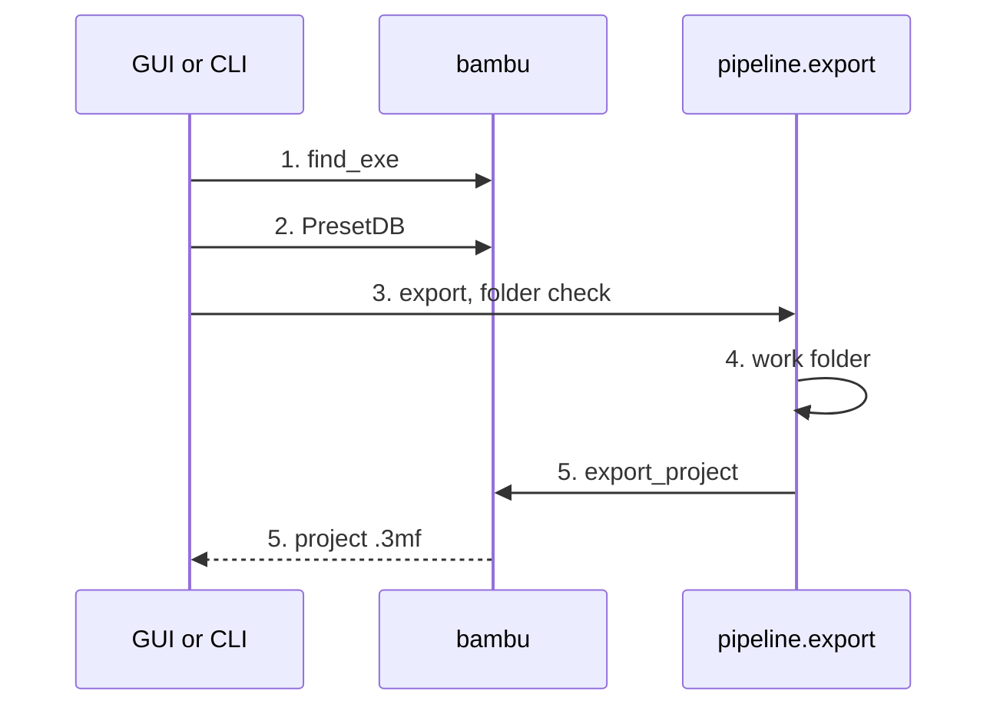

# Linux support

**Approved**: 2026-11-23 - user: "aprovado, pode começar pela S1"
**Settled mid-build:** none
**Review:**
**Fix pass:**

## Problem

On Linux the app never finds Bambu Studio or its presets: it looks only for `bambu-studio.exe` in Windows folders and for presets in `%APPDATA%`. Linux users get STLs only. Evidence: on Pop!_OS 24.04 with the Flatpak 2.9.1, a manual symlink plus `APPDATA`/`TMPDIR` overrides exported and sliced a 3-color project (5 filament changes). With temporaries in `/tmp` the export fails; with the output in `/tmp` the slice check fails.

When this ships, `python app.py` and the CLI on Linux produce a Bambu Studio project with no environment variables.

## Shape

Reuses `find_exe`, `presets_root`, `PresetDB` and the existing export path; nothing is forked per platform. Detection, folder check and temp location live in `bambu` and `pipeline`, covered by `tests/`.

1. GUI or CLI -> `bambu.find_exe` (exists) - Windows candidates as today; on Linux `PATH`, then user Flatpak, then system Flatpak
2. `bambu.PresetDB` (exists) - reads the first presets folder that exists, through `presets_root`
3. `pipeline.export` (exists) - for a Flatpak exe, asks the sandbox whether it sees the output folder and refuses before writing files
4. `pipeline.export` (exists) - puts work files under `~/.cache/img2bambu` on Linux, removes them at the end
5. `bambu.export_project` (exists) - runs the CLI and patches, unchanged; out: project `.3mf`

**Changes underneath**

| Front | What changes |
| --- | --- |
| domain | `exe` meant a Windows executable, now also a native binary, AppImage or Flatpak launcher - GUI and pipeline treat it as a path |
| stored data | nothing to migrate |
| readers | GUI "Executável" field, preset lists, "Abrir pasta"; `README.md` and the CI workflow |

Data: none - no stored entity is touched.

## Surface

None - nothing consumed outside

## Landing

None - paths, checks and messages are all reversible

## Criteria

### S1: The CLI exports and slices a project on Linux (P1)

A person with the Flatpak runs the CLI and gets a verified 3MF.

**Acceptance Criteria**

1. WHEN `find_exe` runs on Linux THEN the system SHALL return the first existing of: `bambu-studio` on `PATH`, `~/.local/share/flatpak/exports/bin/com.bambulab.BambuStudio`, `/var/lib/flatpak/exports/bin/com.bambulab.BambuStudio`
   - `PATH` and Flatpak → `PATH`; only system Flatpak → system Flatpak; none → `None`
2. WHEN presets load on Linux THEN the system SHALL use the first existing of `~/.var/app/com.bambulab.BambuStudio/config/BambuStudio/system/BBL` and `~/.config/BambuStudio/system/BBL`
3. WHILE on Windows the system SHALL use the same executable candidates, presets folder and temp folder as before
4. WHEN a project is exported on Linux THEN the system SHALL keep work files under `~/.cache/img2bambu` and leave none behind, on success or failure
5. WHEN the user runs `python -m img2bambu t.png --check` with the Flatpak and a 3-color image THEN the system SHALL write the `.3mf` and report `ok: True` with at least 1 filament change

### S2: An output folder the Flatpak cannot see is refused (P1)

The user learns the problem before anything is generated.

**Acceptance Criteria**

6. IF the exe is the Flatpak and its sandbox cannot read a file in the output folder THEN export SHALL raise `O Bambu Studio (Flatpak) não acessa a pasta de saída: <pasta>. Escolha uma dentro da sua pasta pessoal.` and write no STL, preview or project
   - `/tmp/x` → refused; folder in home → accepted; folder granted by `flatpak override` → accepted
7. WHEN the exe is not the Flatpak, or no exe is used THEN export SHALL not check the folder
8. WHEN the user clicks "Gerar 3MF" with a refused folder THEN the GUI SHALL show that message as an export error and allow another attempt

### S3: The GUI controls work on Linux (P1)

The user picks the executable and opens the output folder.

**Acceptance Criteria**

9. WHEN the app opens on Linux with the Flatpak and no saved exe THEN "Executável" SHALL hold the Flatpak launcher path and the printer list SHALL not be empty
10. WHEN the user clicks "…" on Linux THEN the picker SHALL list any file; on Windows it SHALL keep `Executável (*.exe)`
11. WHEN the user clicks "Abrir pasta" with an existing folder THEN the system SHALL ask the desktop to open it, on either platform
12. WHEN the user clicks "Abrir no Bambu Studio" after a Flatpak export THEN the system SHALL launch the Flatpak launcher with the project path

### S4: Linux is protected and documented (P2)

**Acceptance Criteria**

13. WHEN CI runs THEN it SHALL run ruff and the non-slow tests on `windows-latest` and `ubuntu-latest`
14. The `README.md` SHALL state how Bambu Studio is found on Linux, and the output-folder limit

## Out of scope

| Excluded | Why |
| --- | --- |
| Linux binary of Img2Bambu (PyInstaller) | user chose native support only |
| Automatic AppImage or Snap detection | no fixed location; picked with "…" |
| Cleaning work folders on Windows | Windows behaviour stays as is |

## Assumptions

| Assumption | Chosen default | Rationale | Confirmed? |
| --- | --- | --- | --- |
| Linux binary | not included | user answer | y |
| Both installs present | `PATH` first | user answer | y |
| Unreachable output folder | refuse before generating | user answer | y |
| CI | add Ubuntu job | user answer | y |
| How reachability is known | probe file read inside the sandbox | exact, respects overrides; a fixed folder list would not | n |
| Both presets folders present | Flatpak's first | same Bambu system presets, whichever exe is used | n |

**Open questions:** none - all resolved or logged above.

## Differences from the source

None - the product matches the source

## Sources

- `request.md` - binding - the request and the accepted success criteria
