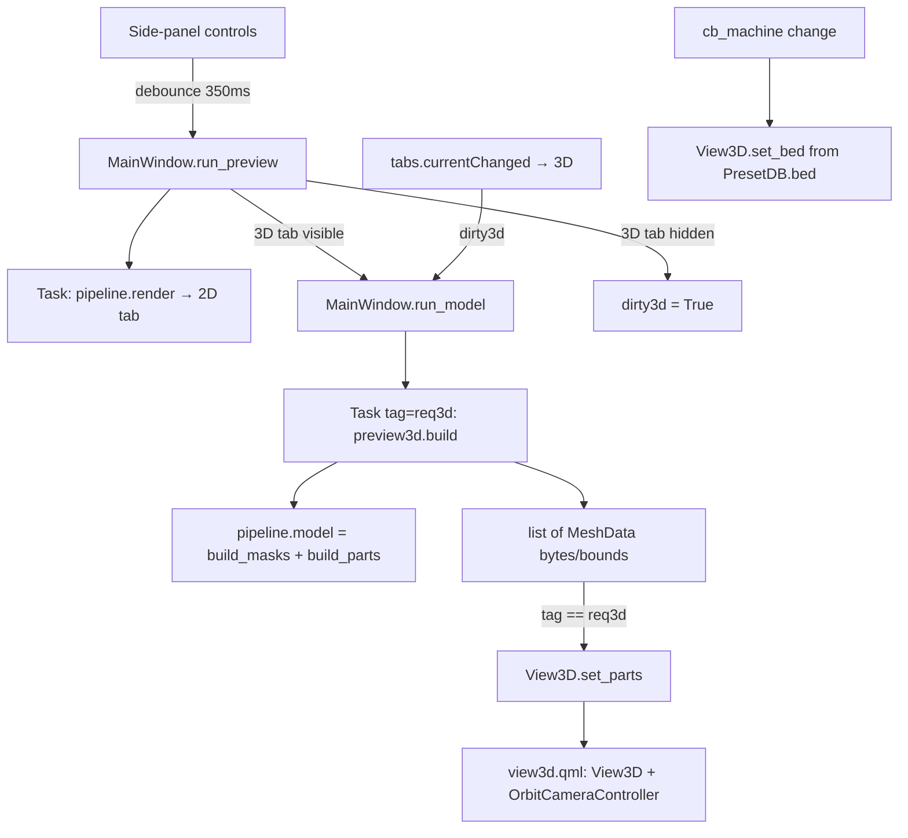

# Preview 3D Design

**Spec**: `.specs/features/preview-3d/spec.md`
**Context**: `.specs/features/preview-3d/context.md`
**Status**: Draft

---

## Research Summary (evidence)

| Question | Finding | Source |
| -------- | ------- | ------ |
| Which 3D modules ship with installed PySide6 6.12? | Qt3D*, QtQuick3D, QtOpenGLWidgets all import; no PyOpenGL/pyqtgraph/pyglet | local import probe |
| Is Qt 3D safe for new code? | No — Qt lists Qt 3D as obsolete, "no longer maintained… advise against using in new code"; alternative = Qt Quick 3D | Context7 `/websites/doc_qt_io_qtforpython-6` (qtdoc-qtmodules) |
| Can Python feed custom meshes to Qt Quick 3D? | Yes — `QQuick3DGeometry` subclass, `setVertexData`/`setStride`/`addAttribute`/`setBounds` (official PySide6 example) | Context7 (example_quick3d_customgeometry) |
| Does it render our real meshes? | Yes — spike with `build_parts` output in `QQuickWidget` rendered correctly in real window | `scratchpad/spike/q3d_quick.py`, `quick_win.png` |
| Does it render with `QT_QPA_PLATFORM=offscreen`? | Loads (`Status.Ready`) but frame is blank white → headless tests can check scene state only, not pixels | `scratchpad/spike/quick_off.png` |
| Camera controls | `QtQuick3D.Helpers.OrbitCameraController`: drag = orbit, wheel = zoom, **Ctrl+drag = pan** (no middle/right-button pan built in) | `PySide6/qml/QtQuick3D/Helpers/OrbitCameraController.qml:68-125` |
| Bed data in presets | `printable_area` (list `"XxY"`) and `printable_height` (string mm) on resolved machine preset; A1 = 256×256×256 | `PresetDB.resolve` probe |
| Packaging | PyInstaller ships `hook-PySide6.QtQuick3D.py`, `hook-PySide6.QtQuickWidgets.py`, `hook-PySide6.QtQml.py` | installed PyInstaller hooks dir |
| Bundle cost | Qt6Quick3D*+Qt6Quick+Qt6Qml DLLs ≈ 31 MB (+ qml dir, not measured) | `du` on PySide6 dir |

---

## Architecture Overview

Meshes are computed off the GUI thread from the same `geometry.build_parts` the export uses, converted to GPU-ready bytes in the worker, and handed to a Qt Quick 3D view inside a new "3D" tab. The view never computes geometry; `MainWindow` decides *when* (tab visible + debounce) using its own request counter.



---

## Code Reuse Analysis

### Existing Components to Leverage

| Component | Location | How to Use |
| --------- | -------- | ---------- |
| `segment.build_masks` + `geometry.build_parts` | `img2bambu/segment.py`, `img2bambu/geometry.py:63` | Sole geometry source (WYSIWYG invariant) |
| `Task` / `QThreadPool` / tag-discard pattern | `img2bambu/gui/worker.py`, `main_window.py:378-394` | Same pattern for 3D task, separate counter |
| Debounce timer | `main_window.py:118` | 3D refresh hooks into `run_preview`; no new timer |
| `PresetDB.resolve` / `bed_center` parsing | `img2bambu/bambu.py:103` | New `bed()` shares the `"XxY"` parsing; `bed_center` reuses it |
| `QTabWidget` tabs | `main_window.py:122-125` | Add third tab |
| `synthetic()` fixture | `tests/test_core.py:15` | Test input for preview tests |

### Integration Points

| System | Integration Method |
| ------ | ------------------ |
| `pipeline` | New `model(an, palette, params) -> list[Part]`; `export` left unchanged |
| `bambu.PresetDB` | New `bed(machine) -> (x0, y0, x1, y1, height) or None` |
| `MainWindow` | New tab, `req3d`, `dirty3d`, `reframe3d`, `run_model`/`model_done`/`model_failed`, bed update in `machine_changed` |
| PyInstaller | `img2bambu.spec` datas += `img2bambu/gui/view3d.qml` |

---

## Components

### `pipeline.model`

- **Purpose**: Return exactly the parts export would build, without the 2D preview image.
- **Location**: `img2bambu/pipeline.py`
- **Interfaces**: `model(an, palette: Palette, params: Params) -> list[geometry.Part]`
- **Reuses**: `segment.build_masks`, `geometry.build_parts`. Raises the same `ValueError`s.

### `preview3d` (Qt-free, unit-testable)

- **Purpose**: Turn parts into render-ready data and compute size/fit facts.
- **Location**: `img2bambu/preview3d.py`
- **Interfaces**:
  - `build(an, palette, params) -> list[MeshData]` — runs in worker thread
  - `mesh_data(part) -> MeshData` — flat-shaded, non-indexed, interleaved float32 `[x, y, z, nx, ny, nz]` per vertex (`len(vertices) == faces * 3 * 24`)
  - `size(meshes) -> (x, y, z)` — combined bbox extents in mm
  - `fits(sz, bed) -> bool` — `x ≤ bed_w and y ≤ bed_d and z ≤ bed_h` (see spec delta below)
- **Dependencies**: numpy, `pipeline.model`

### `PresetDB.bed`

- **Purpose**: Bed rectangle and height for the selected machine.
- **Location**: `img2bambu/bambu.py`
- **Interfaces**: `bed(machine) -> (x0, y0, x1, y1, height) | None` — `None` when `printable_area` missing/unparseable; `height` `None` when `printable_height` missing. `bed_center` reimplemented on top of it, same fallback `(128.0, 128.0)`.

### `View3D` widget

- **Purpose**: Display meshes + bed + info line; no geometry work, no timers.
- **Location**: `img2bambu/gui/view3d.py`, `img2bambu/gui/view3d.qml`
- **Interfaces**:
  - `set_parts(meshes: list[MeshData], reframe: bool)` — replaces models; centers model on bed center (or origin without bed); reframes camera only if `reframe`
  - `set_bed(bed | None)` — redraws bed plane, re-evaluates fit warning, no remesh
  - `show_message(text)` — empty/error state; clears models
  - `part_count() -> int`, `info_text() -> str` — test hooks (scene state, since offscreen renders blank)
  - `ok: bool` — False if QML failed to load; widget then shows only a message label
- **Internals**:
  - `MeshGeometry(QQuick3DGeometry)` built on GUI thread from `MeshData.vertices` (bytes from worker).
  - QML: `View3D` → `Node { eulerRotation.x: -90 }` wrapping models + bed so Z-up mm meshes display upright in Qt Quick's Y-up world; `Repeater3D` over a `parts` list property (`{geometry, color}`), `PrincipledMaterial` per part; bed = `#Rectangle` primitive scaled to bed size, light gray, at z = −0.01.
  - Camera: `OrbitCameraController` (left drag orbit, wheel zoom) + extra `DragHandler` for `Qt.MiddleButton | Qt.RightButton` that translates the orbit origin along its `right`/`up` vectors (own code — see Risks).
  - Overlay `QLabel` under the view: `"150.0 × 120.3 × 11.0 mm — 3 partes"` + optional `"⚠ Modelo maior que a mesa (256 × 256 × 256 mm)."` or `"Mesa indisponível"`.
- **Reuses**: tag/Task pattern lives in `MainWindow`, not here.

### `MainWindow` changes

- **Location**: `img2bambu/gui/main_window.py`
- New state: `req3d` (int), `dirty3d` (bool), `reframe3d` (bool).
- `run_preview` end: `if tab3d is current: run_model() else: dirty3d = True`.
- `tabs.currentChanged`: if 3D and `dirty3d` and analysis → `run_model()`.
- `run_model`: `req3d += 1; dirty3d = False`; `Task(req3d, preview3d.build, analysis, deepcopy(palette), read_params())`.
- `model_done(tag, meshes)`: ignore if `tag != req3d`; `view3d.set_parts(meshes, reframe=reframe3d)`; `reframe3d = False`.
- `model_failed(tag, msg)`: ignore if stale; `view3d.show_message(msg)`; `log_msg`.
- `open_image`: `reframe3d = True`. `machine_changed`: `view3d.set_bed(db.bed(machine))`.
- Without image: tab shows `"Abra uma imagem para ver o modelo 3D."`.

---

## Data Models

```python
@dataclass
class MeshData:          # img2bambu/preview3d.py
    name: str            # Part.name
    color: tuple         # (r, g, b) from Part.color
    vertices: bytes      # float32 interleaved pos(3)+normal(3), flat-shaded, 24 B/vertex
    lo: tuple            # (x, y, z) mesh.bounds[0], mm
    hi: tuple            # (x, y, z) mesh.bounds[1], mm
```

Bed: plain tuple `(x0, y0, x1, y1, height_or_None)` — no class (single use).

---

## Error Handling Strategy

| Error Scenario | Handling | User Impact |
| -------------- | -------- | ----------- |
| `build_parts` raises (empty silhouette, non-watertight) | `Task.failed` → `model_failed` → `show_message(msg)` + log | Message in 3D tab; 2D/export unaffected |
| QML load error / Qt Quick 3D unavailable | `View3D.ok = False` at construction; message label instead of view | "Visualização 3D indisponível: …"; rest of app works |
| Scene-graph/RHI error at runtime | connect `QQuickWidget.sceneGraphError` → message + log | Same as above (signal existence to verify in T-spike, see Risks) |
| No presets / no `printable_area` | `bed() → None` → no plane, "Mesa indisponível" | Model still shown |
| No `printable_height` | height `None` → fit check XY only | Warning still works for XY |
| Stale results | `tag != req3d` → dropped | Only latest shown |

---

## Risks & Concerns

| Concern | Location (file:line) | Impact | Mitigation |
| ------- | -------------------- | ------ | ---------- |
| Shared `self.req` counter for analysis + 2D preview; reusing it for 3D would make `preview_done` discard valid 2D results | `img2bambu/gui/main_window.py:306,381,391` | 2D preview never updates | Separate `req3d` counter; test that 2D preview still lands with 3D tab active |
| `QQuick3DGeometry` is a QObject — must be created on GUI thread | `view3d.py` (new) | Crash/undefined behavior if built in worker | Worker returns `MeshData` bytes only; geometry objects built in `set_parts` |
| Offscreen platform renders blank | `scratchpad/spike/quick_off.png` | No pixel assertions in CI-style tests | Tests assert scene state (`part_count`, `info_text`, bounds); pixel check via manual UAT on real window (`gui_smoke.py` without offscreen) |
| Middle/right-button pan not built into `OrbitCameraController` | `OrbitCameraController.qml:68-84` | Spec AC6 unmet with stock controller | Own `DragHandler` moving orbit origin; keep stock Ctrl+drag too |
| `QQuickWidget.sceneGraphError` availability not verified | — | GPU failure might go silent | Verify in first implementation task; if absent, check `QQuickWidget.status()`/`errors()` only and record gap |
| Bundle grows ≈ 31 MB + qml files; QML file must be in datas | `img2bambu.spec:4` | Missing QML → blank tab in exe | Add to `datas`; task to build exe and open 3D tab |
| Face count on large real images not measured (bee image absent) | — | Possible lag in conversion/upload | Flat-shaded bytes via numpy vectorized (no Python loops); measure on a large image during UAT |
| `export` still recomputes meshes | `img2bambu/pipeline.py:38-41` | Duplicate CPU work | Accepted (spec Out of Scope) |

---

## Tech Decisions

| Decision | Choice | Rationale |
| -------- | ------ | --------- |
| Renderer | Qt Quick 3D in `QQuickWidget` | User choice; maintained (Qt 3D obsolete); spike works; normal widget in tab/splitter |
| Geometry layout | Flat-shaded, non-indexed triangles with face normals | Extruded prints are faceted; sharp edges read relief well; simplest buffer |
| Worker output | Bytes + bounds, not QObjects | Thread-safety (Qt objects on GUI thread) |
| Z-up vs Y-up | Rotate container node −90° about X in QML | Keep mesh data identical to export (mm, Z up) |
| QML delivery | Separate `view3d.qml` file next to `view3d.py` | Readable; PyInstaller datas entry |
| Model placement | Bbox center at bed center | Matches `bed_center` used by `write_minimal_3mf` |

Project-level decision recorded as AD-001 in `.specs/STATE.md`.

---

## Spec Delta (approved 2026-10-22, applied to spec P2 Mesa AC3)

Spec P2 "Mesa" AC3 checks XY only because `printable_height` was unconfirmed. It now is confirmed (A1 = `"256"`). Proposal: AC3 becomes "WHEN bbox X, Y or Z exceeds bed width, depth or `printable_height` THEN show '⚠ Modelo maior que a mesa (W × D × H mm).'"; Z skipped when `printable_height` absent.

---

## Test Strategy

| Level | What | AC |
| ----- | ---- | -- |
| Unit (`tests/test_preview3d.py`) | `preview3d.build` part count, names, colors, bounds == `pipeline.model`/`build_parts` for same input; Z bounds = `[0, base]` and `[base, base+relief]`; vertex byte length; `size`; `fits` incl. boundary; `PresetDB.bed` parsing incl. missing fields; `bed_center` unchanged | PREV3D-01, 06, 07 |
| GUI headless (offscreen, plain `QApplication` fixture) | Tab hidden → param change does not call `preview3d.build` (monkeypatched counter); switching to tab calls once; stale `model_done` ignored; 2D preview still updates; failure → message in `info_text`; no image → empty message; `set_bed(None)` → "Mesa indisponível" | PREV3D-02, 03, 05, 07 |
| Manual UAT (real window) | Orbit/zoom/pan feel; camera kept on param change, reframed on new image; pixels show model on bed; packaged exe 3D tab | PREV3D-04, packaging |
