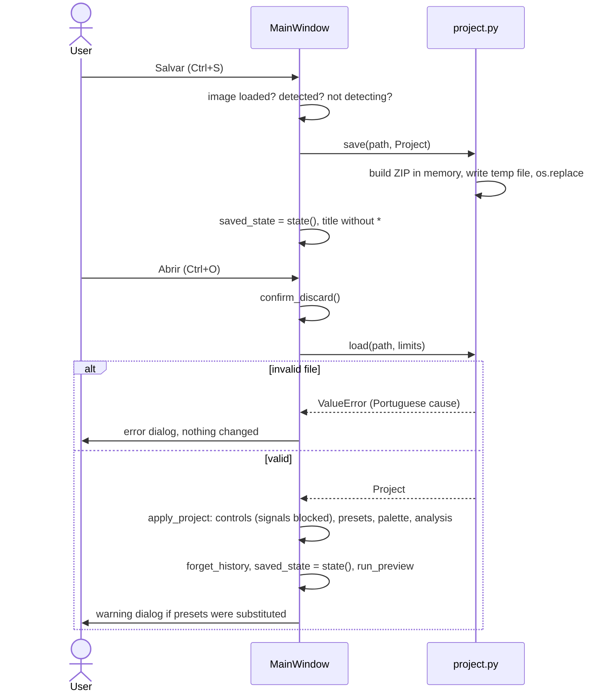

# Project File Design

**Spec**: `.specs/features/project-file/spec.md`
**Context**: `.specs/features/project-file/context.md`
**Status**: Approved - 2026-11-23 - user: "aprovado, podemos seguir para as tarefas"

---

## Research Summary (spike, 2026-11-23, 2000×2000 synthetic image, Suavização 5)

| Question | Finding |
| --- | --- |
| Is `Analysis.lab` exactly storable as 8-bit? | Yes: `np.array_equal` after `uint8` round trip |
| Do `Analysis.centers` survive JSON? | Yes: exact `float32` round trip |
| Cost of the detection result as PNG | labels 69 kB, lab 575 kB; encode 0.04 s + 0.15 s, decode 0.01 s + 0.03 s |

## Approaches

| Approach | Verdict |
| --- | --- |
| **A. ZIP with JSON, original image, detection as PNGs** | chosen: exact on any version, small, inspectable, no new dependency |
| B. ZIP with JSON and image, re-run detection | rejected: breaks "identical colors" (PROJ-01 criteria 4-6) |
| C. Pickle of `Analysis` | rejected: opening a received file could execute code (PROJ-03 criterion 9) |

## Architecture Overview

`img2bambu/project.py` (Qt-free) owns the file format, its validation and the atomic write.
`MainWindow` converts controls to and from it. Opening validates the whole file before the window changes anything.



**Where the rules run.** Format, validation and reconstruction: `project.py`, tested in `tests/test_project.py`.
Presets, unsaved marks and guards: `MainWindow`, tested offscreen in `tests/test_gui_project.py`.

---

## Code Reuse Analysis

| Component | Location | How to Use |
| --- | --- | --- |
| `Params`, `Palette` | `img2bambu/params.py` | stored field by field; `Params()` gives the default of a missing setting |
| `Analysis` | `img2bambu/segment.py:11` | rebuilt from the file without `analyze` |
| `segment.load_image` | `img2bambu/segment.py:26` | already accepts a binary file object (`Image.open`) |
| `self.fields` + `ck_lines` | `main_window.py` | list of controls to fill, and the spin box ranges used as validation limits |
| `forget_history`, `build_rows`, `run_preview`, `self.req` | `main_window.py` | same restore sequence `undo` uses |
| `machine_changed` / `PresetDB.defaults` | `main_window.py`, `bambu.py` | default presets of the printer |
| Fixtures `win`, `settle`, `presets` | `tests/test_gui_preview3d.py` | GUI tests |

---

## Components

### `project` (new)

- **Purpose**: read, validate and write `.i2b` files
- **Location**: `img2bambu/project.py`
- **Interfaces**:
  - `Project` dataclass - `image_name`, `image` (bytes), `params`, `palette`, `analysis`, `machine`, `process`, `filament`, `check`, `name`, `rgba` (decoded on load), `notes` (defaults used)
  - `settings(p: Project) -> dict` - JSON content without arrays; also what the unsaved mark compares
  - `save(path, p: Project)` - raises `OSError`; the previous file stays intact
  - `load(path, limits: dict) -> Project` - `limits` is `{params field: (min, max)}`; raises `ValueError` in Portuguese for anything invalid
- **Dependencies**: `zipfile`, `json`, PIL, numpy

### `MainWindow` (changed)

- `_menu()` - menu "Arquivo" and shortcuts
- `save_project()`, `save_project_as()` -> bool (saved or not), `open_project()`
- `current_project()` - builds `Project` from controls and state
- `apply_project(path, p)` - fills the window; bumps `self.req` and `self.req3d`, clears `detecting`, `stale2d`, `fresh_image`, sets `reframe3d`, resets the debounce and the 2D fit
- `apply_presets(p) -> list` - substitutions as (kind, missing, substitute)
- `confirm_discard() -> bool` - the question of PROJ-04; called by `closeEvent`, `open_project`, `open_image`
- `update_title()` - called from `record`, `undo`, `analysis_done`, `forget_history` and the signals of machine, process, filament, check and name
- New state: `image` (name, bytes), `project_path`, `saved_state`, `kept_presets`
- `open_image` reads the bytes once, decodes them from memory and clears `project_path`

---

## Data Models

ZIP, all members read by name; unknown members are ignored.

| Member | Content |
| --- | --- |
| `project.json` | below |
| `image` | original bytes, stored without recompression |
| `labels.png` | mode L, crop size, label + 1, 0 = outside the silhouette |
| `lab.png` | mode RGB holding the crop's OpenCV LAB; zeros outside the silhouette |

```json
{
  "format": 1,
  "image_name": "abelha.png",
  "params": {"background": "alpha", "bg_tolerance": 30, "n_colors": 3, "filaments": 0, "smooth": 0,
             "min_detail_mm": 0.5, "streak_radius_mm": 1.0, "protect_lines": false,
             "width_mm": 150.0, "base_mm": 10.0, "relief_mm": 1.0},
  "palette": {"colors": [[0, 0, 0]], "samples": [[0, 0, 0]], "base_index": 0, "merges": [[1, 0]],
              "streak": [], "outline": [], "edited": []},
  "detection": {"offset": [0, 0], "base": 0, "centers": [[0.0, 128.0, 128.0]], "samples": [[0, 0, 0]]},
  "presets": {"machine": "", "process": "", "filament": ""},
  "check": true,
  "name": "abelha"
}
```

**Required**: `format`, `image_name`, `palette`, `detection` and the three other members. Every key of `params`, `presets`, `check` and `name` has a default, used with a log line.
**`format`** grows only when an older app would misread the file; a new setting with a default keeps it.

**Validation**: exact types (`bool` is not a number, `NaN` is out of range); 2-8 colors, with matching
`samples` and `detection`; RGB 0-255; indices within the rows; merges without cycles; active base;
`streak` and `outline` disjoint; PNG modes, sizes and label values; crop inside the image; silhouette not empty.
PNG sizes are compared before decoding. Each member is at most 1 GiB; Pillow's pixel limit applies to the images.
`name` and `image_name` are reduced to their last path component (`/` and `\`), with a log line when that changes them.

---

## Error Handling Strategy

| Error Scenario | Handling | User Impact |
| --- | --- | --- |
| Not a ZIP, truncated, bad JSON, missing member, bad value | `load` raises before the window changes | "Não foi possível abrir o projeto:" + cause |
| `format` newer | checked before anything else in the JSON | "Este projeto foi salvo por uma versão mais nova do Img2Bambu." |
| Write error | temp file beside the target removed, target untouched | "Não foi possível salvar o projeto:" + cause |
| Missing presets | substitute, or keep the names with no presets installed | one warning dialog + log lines |
| Save while detecting / without detection / without image | refused | messages of PROJ-01 criteria 17-19 |

---

## Risks & Concerns

| Concern | Location | Impact | Mitigation |
| --- | --- | --- | --- |
| Received file is untrusted; `name` is joined to the output folder | `pipeline.py`, `os.path.join(outdir, ...)` | a crafted name could write outside the folder | last path component only; no pickle; nothing extracted |
| Control signals start detections while being filled | `main_window.py` `reanalyze` connections | detection would overwrite the restored palette | block signals as `undo` does; test asserts `segment.analyze` is not called |
| `machine_changed` clears process and filament | `main_window.py` | restored values lost | printer first, then the other two |
| Old tasks finishing after opening | `self.req`, `self.req3d` | stale preview on the new project | bump both; tested with a task in flight |
| Temp file of `tempfile` is mode 0600 | `project.save` | shared file unreadable by others | plain `open(..., "xb")`, then `os.replace` on the real path |
| Saving is synchronous | GUI thread | ≈0.2 s of pause at 4 MP | accepted; the closing guard stays simple |
| JPEG decoders may differ by a level between Pillow versions | `sample_at` | a later eyedropper pick may differ slightly on another computer | accepted; masks use the stored LAB |
| A dirty project opens a modal dialog when a test closes the window | `closeEvent` | pytest hangs | fixture in `test_gui_project.py` stubs `QMessageBox`; run under `timeout` |
| Tests and `gui_smoke.py` set `w.rgba` directly | `tests/` | no image bytes, so saving says "Abra uma imagem primeiro." | project tests load through `open_image` with a real PNG |

---

## Tech Decisions

| Decision | Choice | Rationale |
| --- | --- | --- |
| Validation limits | passed from the spin boxes | one source for the ranges |
| Unsaved mark | compares `settings()` dicts, not arrays | cheap on every change; the detection follows from the values |
| Dialog folder | project's folder, else the image's, else the remembered one | no new `QSettings` key |
| Project-level | AD-003 in `.specs/STATE.md` | every new window control must be saved |
