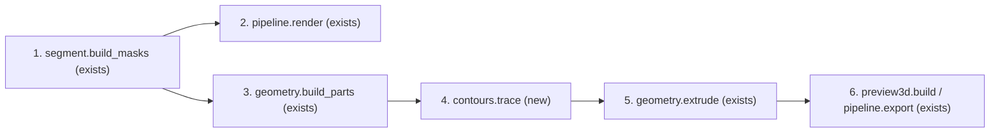

# Smooth contours without gaps

**Approved**: 2026-11-23 - user: "aprovado"
**Settled mid-build:** none
**Review:** <written when the review is sent - sent at <HEAD short hash>>
**Fix pass:** <written when the fix pass is made - done - <what it changed, or no changes needed>>

## Problem

Walls of the exported piece follow the pixel staircase, and neighbouring colors do not touch, so the
base color can show between them. Whoever prints pays in rough walls and unwanted lines.
Measured 2026-11-23 on `main` (code of `eaf6052`), 150 mm, default `Params`, a disc split in two colors:

| Image | Gap between colors | Accumulated turn of the outline (ideal 1) | Width |
| --- | --- | --- | --- |
| 600 px | 0.130 mm | 170 turns | 149.87 mm |
| 1200 px | 0.066 mm | 90 turns | 149.93 mm |
| 2400 px | 0.034 mm | 14 turns | 149.97 mm |

Causes: `findContours` runs through pixel centers; `simplify_mm` 0.04 is below the pixel size of the
first two. On the dino image (8 colors → 4 filaments) mask cleaning also leaves bare strips up to
about 0.5 mm between colors: 458 mm² of 17,167 mm², 250 mm² of it not base-colored in the image.

Nothing has been printed or sliced for this measurement.

When this ships, curved and slanted walls come out smooth, sharp corners stay sharp, neighbouring
colors meet along one line, and strips the image does not paint in the base color are filled.

## Shape

This reuses `build_masks`, `build_parts` and `extrude`; CLI, 3D and export already go through them.
Every rule runs in `img2bambu/segment.py` (filling) or `img2bambu/contours.py` and `img2bambu/geometry.py` (contours), reached by
`tests/test_core.py` and siblings.

1. image, palette and params -> `segment.build_masks` (exists) - cleans and protects lines as today, then fills strips (S2); hands on disjoint masks
2. `pipeline.render` (exists) - draws the 2D preview from those masks, pixel by pixel as today
3. `geometry.build_parts` (exists) - hands the silhouette and all masks together to the tracer
4. `contours.trace`, called by `geometry` (new) - splits pixel-edge boundaries at points where three or more regions meet, smooths each shared stretch once, keeps corners, rebuilds one polygon set per part
5. `geometry.extrude` (exists) - makes the meshes; the existing watertight check stays
6. out: meshes -> `preview3d.build` (exists) and `pipeline.export` (exists) -> 3D tab, STLs, 3MF

**Changes underneath**

| Front | What changes |
| --- | --- |
| domain | a part's polygons depend on all masks, no longer on its own mask alone; contours run along pixel edges |
| domain | `build_masks`: non-base strips between two colors now belong to one of them, amending thin-lines criterion 1 ("same masks as today") |
| stored data | nothing - no persisted field or setting |
| readers | 2D preview and `_preview.png` (filled strips only, criterion 11); 3D tab, STLs, 3MF (criterion 8) |
| domain | `Params.simplify_mm` and `geometry.to_polys` per mask are gone: `to_polys` takes all masks |
| readers | `test_preview3d.py` width tolerance, which states the old lost pixel: tightened with criterion 4 |
| readers | color percentages: unchanged, counted before cleaning |

Data: none - nothing stored is touched.

Feasibility spike (ideal disc masks of 150 and 4 mm): smoothing the midpoints of pixel edges with about 1 px
tolerance gives 1.00 turn and at most 0.67 px of deviation. It did not cover `build_masks` output,
junctions, corners or thin lines.

## Surface

None - nothing consumed outside; no control or CLI option is added

## Landing

None - no persisted schema, no new dependency, no contract; the geometry is recomputed on every run

- Nothing else in this change is hard to reverse

## Criteria

"px" = one pixel of the upsampled mask, in mm. "Corner" = a change of direction ≥ 45° of the mask's
boundary, measured between stretches of at least 1 mm on each side.

### S1: Smooth shared contours in every export (P1)

The user exports as today; curves are smooth and colors touch.

**Acceptance Criteria**

1. WHEN two colors are adjacent in the masks THEN the distance between their polygons SHALL be ≤ 0.005 mm
   all along the shared boundary, with overlap area 0 (≤ 1e-6 mm²)
   - two half discs at 600, 1200 and 2400 px; strong case: curved S-shaped boundary, and three colors
     meeting at one point
2. The outline of a disc SHALL turn ≤ 1.2 turns in total and ≤ 15° at any vertex
   - 150 mm disc at 600, 1200 and 2400 px; strong case: 4 mm disc at 600 px over 150 mm
3. The smoothed boundaries SHALL stay within 1 px of the mask's pixel-edge boundary, in both directions
4. The base's width SHALL equal the silhouette mask's width, counted in full pixels, ± 0.02 mm
   - disc at 600, 1200 and 2400 px → 150 ± 0.02; a filled rectangle → 150 ± 0.02
5. WHEN the mask's boundary has a corner THEN the polygon SHALL have a vertex within 1 px of it
   whose direction change, over 1 mm stretches, is within 10° of the mask's
   - square, also rotated 30°; star with 36° tips; strong case: a 60° deviation (hexagon) stays,
     and a disc gains no corner
6. IF an edge has only changes of direction below 45° THEN no vertex SHALL turn more than 15°
   because of the staircase
   - straight edges at 7°, 30° and 45°: accumulated turn ≤ 15° over the edge
7. The lines protected by "Contorno" SHALL stay ≥ 0.42 mm − 1 px wide, as a raised color and as a gap of the
   base color, and stay in one piece
8. The 3D tab, STLs and 3MF SHALL be made from the same parts; all meshes SHALL be watertight and every
   raised part inside the base outline (area outside ≤ 1e-6 mm²), heights unchanged
   - regions linked only by a diagonal pixel; strong case: a ring closed by one; a hole filled by another color
9. IF smoothing makes boundaries cross or a region invalid THEN the system SHALL use the pixel-edge
   boundary for the stretches involved, with criteria 1 and 8 still true
   - mask with boundaries 1 px apart → no part lost, no mesh error
10. The same image and parameters SHALL give identical meshes on two runs

### S2: Bare strips between colors are filled (P2)

Strips left by cleaning take a neighbouring color where the image is not base-colored.

**Acceptance Criteria**

11. WHEN a bare, non-base-colored pixel is in a strip ≤ 0.5 mm wide (± 1 px) between two different raised colors THEN it SHALL go
    to the nearer color. "Base-colored" = its image color, after merges, is the base. Ties go to the lower label; the 2D preview
    shows the result
    - 0.3 mm strip of a dropped third color → filled, half to each side; 0.45 mm → filled; 0.7 mm → bare
12. IF a pixel is base-colored, or belongs to a protected base line THEN it SHALL stay bare
    - 0.3 mm base line marked "Contorno" → a continuous gap ≥ 0.42 mm − 1 px; unmarked → only what cleaning covers today
13. IF a pixel's color has "Filtro reflexo" on (radius > 0) THEN it SHALL stay bare
    - 0.3 mm highlight streak between two colors → bare as today
14. IF a bare strip lies within one color, or between a color and the silhouette edge THEN it SHALL stay as today
15. The filling SHALL keep masks disjoint and inside the silhouette, take no pixel from any mask, and
    leave images with no such strip pixel for pixel as today

## Out of scope

| Excluded | Why |
| --- | --- |
| A control or CLI option to turn smoothing off | user chose always on |
| Smooth contours in the 2D preview | user chose to keep pixels |
| Strips inside one color or along the silhouette edge | the question covered strips between two colors |
| Chamfer, inlay, different heights per color | other items of the list; user picked 1 and 2 |
| Corners already rounded by mask cleaning | corners are preserved relative to the mask; cleaning is separate |
| Confirmation on a printed piece | needs the user's printer |

## Assumptions

| Assumption | Chosen default | Rationale | Confirmed? |
| --- | --- | --- | --- |
| Control | always on | user chose it | y |
| Strips | filled up to 0.5 mm, fixed; never base-colored nor "Filtro reflexo" pixels | user chose it | y |
| Corners | deviation ≥ 45° over 1 mm on each side | user chose it | y |
| 2D preview | stays pixel-based | user chose it | y |
| Strip with mixed colors | only its non-base pixels are filled; the base-colored part stays | follows the chosen rule | n |
| Detail under 1 mm | an edge too short for the corner rule may be rounded, up to 1 px | criterion 3 bounds it | n |
| Pixel art | its steps ≥ 1 mm on both sides stay, smaller ones smooth | follows the corner rule and "always on" | n |
| Contact | the 1 µm inset per side may stay, a 0.002 mm gap | keeps diagonal links manifold; below the 0.005 bound | n |
| Scale | outline and all colors scaled together to meet criterion 4 | smoothing may shift an extreme by a fraction of a px | n |

**Open questions:** none - all resolved or logged above.

## Differences from the source

None - the product matches the source

## Sources

- `request.md` - binding - items 1 and 2 and their success criteria
- `workdir/cha-bebe/Gemini_Generated_Image_yah5wqyah5wqyah5.png` - non-binding - measurement only (Problem)
