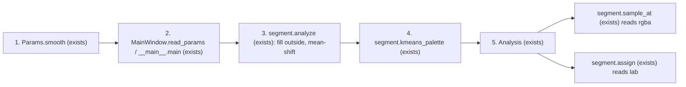

# Smoothing before clustering (Suavização)

**Approved**: 2026-11-22 - user: "aprovado"
**Settled mid-build:** none
**Review:** <pending>
**Fix pass:** <pending>

## Problem

AI-generated images carry gradients, antialiasing and speckle noise. `segment.analyze` clusters and
assigns every silhouette pixel by its raw color, so transition pixels become thousands of tiny
islands. `segment.clean` later erases them, and that same morphological opening sometimes takes thin
detail with it. Evidence: `.specs/melhorias-cores.md` §3 ("achata degradês e remove pixels de
transição entre cores"). Measured on `workdir/cha-bebe/Gemini_Generated_Image_yah5wqyah5wqyah5.png`
(k=6, color background): 7346 raw label islands, 7115 of them under 20 px. Mean-shift 12/24 brings
that to 7027 and leaves the final regions about the same (142 → 143), so on this image the gain is
small. It is expected to matter on images with strong gradients. Hence: optional, off by default.

When this ships, the user can set "Suavização" (0–5) in the GUI, or `--smooth N` in the CLI. The
colors are then detected and assigned on a mean-shift-filtered copy of the image, so gradients
collapse into flat areas before k-means. At 0 the result is identical to today.

## Shape

This reuses the existing analysis path: the filtered image feeds `kmeans_palette` and the per-pixel
LAB that `assign` already reads, and re-analysis and `carry_over` work as they do for "Nº de cores".
The filter rule (level → mean-shift strength, outside-silhouette fill, 0 = untouched) lives in
`img2bambu/segment.py`, where `tests/test_core.py` covers it. The GUI control is covered in
`tests/test_gui_palette.py`, and the CLI flag in `tests/test_core.py`.

1. user sets "Suavização" (GUI spin box) or `--smooth N` (CLI) -> `Params.smooth` (exists, new field)
2. `gui/main_window.MainWindow.read_params` / `__main__.main` (exists) - hand `Params` to `segment.analyze`
3. `segment.analyze` (exists) - after the crop, if `smooth > 0`: fill pixels outside the silhouette
   with the nearest silhouette pixel's color, run `cv2.pyrMeanShiftFiltering` on the RGB, and hand
   the result to `kmeans_palette` (new helper in `segment`)
4. `segment.kmeans_palette` (exists) - clusters on the filtered pixels → labels, colors, centers, `lab`
5. out: `Analysis` (exists) keeps the **original** cropped `rgba` (the eyedropper `sample_at` reads
   it) and the **filtered** `lab` (`assign` reads it for preview and export)

**Changes underneath**

| Front | What changes |
| --- | --- |
| domain | `Analysis.lab`, `centers`, `samples`, `palette.colors` come from the filtered image when `smooth > 0`, while `Analysis.rgba` stays the original crop. Today `sample_at` reads `rgba` and `assign`/`kmeans_palette` read `lab`, and nothing assumes the two agree |
| stored data | nothing - `Params` is in memory only, and the tuning fields are not persisted in `QSettings` |
| readers | preview tab, percentages, 3D tab, export (via `lab`/`assign`); the eyedropper via `rgba`, which is unchanged |

Data: none - nothing is persisted.

## Surface

None - nothing consumed outside over HTTP. The one external signature that changes is the CLI (anyone may call it):
`python -m img2bambu image --smooth N`, where `N` is an integer 0–5 and defaults to 0. The outputs
are the same as today. Exit code 0 on success. Exit code 2 (argparse error) when `N` is out of
range or not an integer.

## Landing

None - no persisted schema, no new dependency (`cv2.pyrMeanShiftFiltering` is in the existing
OpenCV), and the CLI flag is additive with a default that keeps today's behaviour.

- Nothing else in this change is hard to reverse

## Criteria

### S1: Suavização in the GUI (P1)

The user sets "Suavização" and sees the colors re-detected on the smoothed image.

**Acceptance Criteria**

1. The system SHALL have `Params.smooth`, an integer with default 0.
2. WHILE `smooth == 0` the system SHALL produce an `Analysis` whose `labels`, `lab`, `centers`,
   `palette.colors` and `samples` equal today's output for the same image and params
   - any image, smooth 0 → identical arrays to an analysis without the field
3. WHEN `smooth = k` with 1 ≤ k ≤ 5 THEN `segment.analyze` SHALL cluster and compute `lab` on
   `cv2.pyrMeanShiftFiltering(rgb, sp=4·k, sr=8·k)` of the cropped image
4. WHEN `smooth ≥ 1` on a synthetic image with a two-color gradient plus noise THEN the system SHALL
   produce fewer 8-connected label components than with `smooth = 0`
5. The system SHALL make the analysis independent of the RGB of pixels outside the silhouette
   - two RGBA images that differ only in the RGB of their transparent pixels (black vs white), smooth 3 →
     identical `labels` and `palette.colors`; the strong case is a dark transparent background next to a
     light edge, which without the fill would leave a dark ring
6. WHILE `smooth ≥ 1` the system SHALL keep `Analysis.rgba` equal to the original cropped image, so
   `sample_at` returns the original image's mean color
   - smooth 3, click on a noisy pixel → the 5×5 mean of the original pixels, not of the filtered ones
7. The GUI SHALL show a "Suavização:" spin box in the "2. Cores" group, range 0–5, step 1,
   default 0, tooltip "Achata degradês antes de detectar as cores (0 = desligado)"
8. WHEN the user changes "Suavização" with an image loaded THEN the system SHALL re-analyze
   (status "Detectando cores…") with the new value in `Params.smooth`, keep the edited rows via
   `carry_over`, and refresh the preview, as a change of "Nº de cores" does
9. WHEN the user changes "Suavização" with no image loaded THEN the system SHALL do nothing (no
   analysis, no error)

### S2: `--smooth` on the CLI (P2)

The CLI accepts the same level and hands it to the same analysis.

**Acceptance Criteria**

10. WHEN the CLI runs with `--smooth N` (0 ≤ N ≤ 5) THEN the system SHALL analyze with
    `Params.smooth = N`; without the flag it SHALL use 0
11. IF `--smooth` is outside 0–5 or not an integer THEN the CLI SHALL exit with code 2 and an argparse
    error naming `--smooth`, before reading the image
    - `--smooth 6` → exit 2; `--smooth -1` → exit 2; `--smooth 5` → accepted

## Out of scope

| Excluded | Why |
| --- | --- |
| Bilateral or median filter | user chose mean-shift. Median 5 was measured and erases contours and leaves |
| Showing the smoothed image in the Original tab | Original shows what was loaded, and the eyedropper reads the original (user choice) |
| Persisting "Suavização" across sessions | the other tuning fields (Nº de cores, Detalhe mínimo) are not persisted |
| Running the filter at reduced resolution | measured ~1.7 s at 3000×3200 for level-5-like strength, in the background worker |
| Smoothing inside `build_masks` / `clean` | the request scopes it to analysis. Cleaning is improvement 5 |

## Assumptions

| Assumption | Chosen default | Rationale | Confirmed? |
| --- | --- | --- | --- |
| Filter | mean-shift (`cv2.pyrMeanShiftFiltering`) | user chose it: flattens gradients into plateaus | y |
| Control and default | integer levels 0–5, default 0 = off | user chose it | y |
| Eyedropper source | original image (`Analysis.rgba` unfiltered) | user chose it | y |
| CLI | `--smooth N`, default 0 | user chose it | y |
| Level → strength | `sp = 4·k` px, `sr = 8·k` (level 3 ≈ 12/24, the measured setting) | spreads the 5 levels from barely visible to strong, and the tuning is cheap to change later | n |
| Filament color of each group | median of the **filtered** pixels in the group | follows the `lab` used to group, and the median barely moves (measured ±4 per channel) | n |
| Outside-silhouette fill | nearest silhouette pixel's color, before filtering | without it, transparent pixels (often black) bleed into the edge colors | n |

**Open questions:** none - all resolved or logged above.

## Differences from the source

None - the product matches the source

## Sources

- `.specs/melhorias-cores.md` §3 - binding - scope: optional pre-filter before k-means/assignment, a "Suavização" control with 0 = off, `Params` field, test with a synthetic gradient
- `workdir/cha-bebe/Gemini_Generated_Image_yah5wqyah5wqyah5.png` - non-binding - measurement only (table in Problem)
