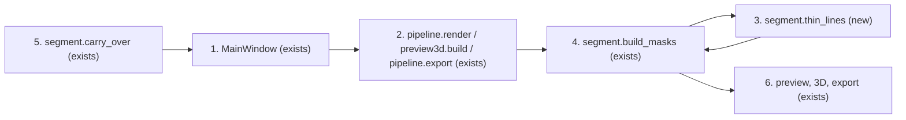

# Protect thin lines (Contorno)

**Approved**: 2026-11-23 - user: "aprovado"
**Settled mid-build:** none
**Review:** sent at b2f3788
**Fix pass:** done - finding 1: the automatic 0.42 mm rule uses the width averaged along the line, so slanted lines stay whole; 2: width estimate corrected for short shapes; 3: rejoin by connection, not distance; tests for each, plus silhouette clipping, the joined thick part, and unmarked output

## Problem

Outlines, antennae, veins and stems are what makes the art readable, and they disappear or break up
when they are thinner than "Detalhe mínimo" (0.5 mm) or than the radius of "Filtro reflexo".
Evidence: `.specs/melhorias-cores.md` §5 and its Diagnosis. Measured 2026-11-23 on
`workdir/cha-bebe/Gemini_Generated_Image_yah5wqyah5wqyah5.png` (8 colors → 4 filaments, 150 mm,
0.252 mm/px): the outline color is the base color, so its lines are gaps between raised colors, and
the morphological closing of the neighbour colors fills them. The rings around the dino's spots
become dashes. Opening-off alone restores them, but also brings every other speck back.

When this ships, the user marks a color as "Contorno" and its lines come out continuous and wide
enough to print, or turns on "Proteger traços finos" to keep the printable lines of every color.
With neither, the output is identical to today.

## Shape

This reuses `build_masks`, `Palette` per-row marks (as `streak`), the snapshot undo (AD-002) and the
preview/3D/export paths, which all read `build_masks`. Every rule that changes an outcome (what is a
line, widening, priority, marks on re-analysis) runs in `img2bambu/segment.py`, reached by `tests/test_core.py`;
the controls are covered in `tests/test_gui_palette.py`.

1. user ticks "Contorno" on a row (`Palette.outline`, new field) or "Proteger traços finos" (`Params.protect_lines`, new field) -> `MainWindow` (exists) - records undo, schedules the preview
2. `pipeline.render` / `preview3d.build` / `pipeline.export` (exists) - call `segment.build_masks`
3. `segment.thin_lines` (new) - for a color's pixels, finds the lines thinner than max("Detalhe mínimo", 0.42 mm), drops short or stubby ones; widens them (marked) or drops those narrower than 0.42 mm (automatic)
4. `segment.build_masks` (exists) - cleans as today, then gives each protected line to its color and takes it from every other raised color
5. `segment.carry_over` (exists) - carries the mark of edited rows to the re-detected row
6. out: `{label: mask}` -> preview, 3D, export/STLs (exist)

**Changes underneath**

| Front | What changes |
| --- | --- |
| domain | `Palette` gains the set `outline`; a label is never in both `outline` and `streak` |
| domain | `build_masks`: the base color, which has no mask, can now cut gaps in raised colors |
| stored data | nothing - `Params` and `Palette` live in memory only |
| readers | Cores (prévia), 3D, percentages (unchanged: counted before cleaning), export/STLs, undo snapshots |

Data: none - nothing is persisted.

## Surface

None - nothing consumed outside

## Landing

None - in-memory fields with defaults that keep today's output; no dependency, no persisted schema

- Nothing else in this change is hard to reverse

## Criteria

Widths and lengths are in mm of the printed piece. "Line" = part of a color thinner than
max("Detalhe mínimo", 0.42 mm) whose length is ≥ 2 mm and ≥ 3× its width.

### S1: A color marked "Contorno" keeps its lines (P1)

The user ticks "Contorno" on a row and the preview shows its lines whole.

**Acceptance Criteria**

1. WHILE `Palette.outline` is empty and `Params.protect_lines` is False the system SHALL produce the same
   masks as today, pixel for pixel; a newly opened image SHALL have no
   marked color, and `protect_lines` SHALL start False when the app starts (opening another image keeps it, as Suavização)
2. WHEN a raised color is in `outline` THEN its lines SHALL be in its mask, even below "Detalhe mínimo"
   - 0.6 mm × 40 mm line, "Detalhe mínimo" 1.0 → kept end to end in one piece; unmarked → gone;
     0.25 mm (1 px) line, also diagonal → kept in one piece
3. IF a part of a marked color below "Detalhe mínimo" is not a line THEN it SHALL follow today's rule
   - 0.6 mm² square speck, "Detalhe mínimo" 1.0 → gone; 0.5 × 1.5 mm dash → gone
4. WHERE a line of a marked color is narrower than 0.42 mm the system SHALL widen it to 0.42 mm
   (± 1 pixel of the upsampled mask), within the silhouette; a line already ≥ 0.42 mm SHALL keep its width
5. WHEN the marked color is the base THEN no raised color SHALL cover its lines
   - 0.3 mm ring of base color inside a raised color → a continuous ring of at least 0.42 mm with no
     raised mask; unmarked → closed over as today
6. The lines of a marked color SHALL be taken from every other raised color; between two marked colors the
   lower label wins; masks SHALL stay disjoint and inside the silhouette, and the meshes watertight
7. IF cutting a line out of a color leaves a piece smaller than 0.3 mm² THEN that piece SHALL be dropped
8. The color rows SHALL each show a "Contorno" checkbox, off by default, enabled for the base row too and
   disabled on a merged-away row, whose mark has no effect
9. WHEN the user ticks "Contorno" THEN "Filtro reflexo" of that row SHALL untick, and the reverse; one
   undo step restores both
10. WHEN the user toggles "Contorno" THEN the preview SHALL be rebuilt without detecting colors again,
    and Ctrl+Z SHALL undo it as the step "Contorno"
11. WHEN colors are detected again THEN the mark (on or off) of each edited row SHALL follow it to its new row with
    criterion 9's exclusion, and every other row SHALL come back unmarked; ticking the mark SHALL NOT make a row edited

### S2: "Proteger traços finos" protects every color (P2)

One switch keeps the printable lines without marking colors.

**Acceptance Criteria**

12. WHEN `protect_lines` is True THEN the lines ≥ 0.42 mm wide of every unmarked active color SHALL be
    kept at their own width, base included (as gaps, criterion 5), except colors in `streak`
    - "Detalhe mínimo" 1.0: 0.6 mm line → kept; 0.25 mm line → gone; 0.6 mm line of a "Filtro reflexo"
      color → gone as today
13. Where lines overlap, those of marked colors SHALL win over automatic ones
14. The "2. Cores" group SHALL show a "Proteger traços finos" checkbox, off by default; toggling it with
    an image loaded SHALL rebuild the preview without detecting again, and Ctrl+Z SHALL undo it as the
    step "Proteger traços finos"; with no image loaded it SHALL only keep the choice

## Out of scope

| Excluded | Why |
| --- | --- |
| CLI options for "Contorno" or "Proteger traços finos" | user chose not now |
| Marking a color as "Contorno" automatically | user chose none marked by default |
| Dots and highlights that are not lines (eye glints, small teeth) | user chose the length rule; today's rule applies |
| Lines that stick out of the silhouette and are removed by the silhouette's own cleaning | §5 is about color masks; changing the silhouette changes the base part |
| Marking "Contorno" per region instead of per color | not asked |

## Assumptions

| Assumption | Chosen default | Rationale | Confirmed? |
| --- | --- | --- | --- |
| Detection | both: per-row "Contorno" and a global automatic switch | user chose it | y |
| Too-thin lines of a marked color | widened to 0.42 mm | user chose it | y |
| Base color can be marked | yes, opens gaps | user chose it | y |
| Contorno vs. Filtro reflexo | ticking one unticks the other | user chose it | y |
| Marked by default | none | user chose it | y |
| What is a line | length ≥ 2 mm and ≥ 3× width | user chose it | y |
| Mark on re-detection | kept on edited rows only | user chose it | y |
| Global switch default | off | user chose it | y |
| Automatic width | only ≥ 0.42 mm, not widened | user chose it | y |
| Automatic reach | base included, Filtro reflexo colors excluded | user chose it | y |
| 0.42 mm fixed | not tied to the nozzle chosen | the app has no nozzle field in `Params`; §5 gives ~0.42 for a 0.4 nozzle | n |
| Persistence of the switch | not saved | like Suavização and Filamentos | n |

**Open questions:** none - all resolved or logged above.

## Differences from the source

None - the product matches the source

## Sources

- `.specs/melhorias-cores.md` §5 - binding - scope: thin lines survive, noise goes, optional outline color with priority
- `workdir/cha-bebe/Gemini_Generated_Image_yah5wqyah5wqyah5.png` - non-binding - measurement only (Problem)
