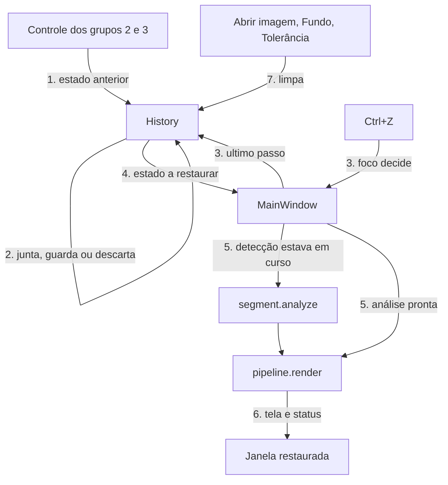

# Desfazer com Ctrl+Z

**Approved**: 2026-11-23 - user: "aprovado"
**Settled mid-build:** none
**Review:** sent at 70112e6
**Fix pass:** done - merge cycles are refused and keep the previous merge (P1), `Nada para desfazer.` survives a running preview (P2), steps that would change nothing are skipped (P3); P4 and P5 left as reported

## Problem

Hoje nenhum ajuste de cor ou dimensão na janela pode ser revertido. Quem erra uma cor, uma mesclagem ou um número precisa lembrar o valor anterior e refazê-lo à mão. Mudar `Nº de cores`, `Filamentos` ou `Suavização` custa mais: a redetecção apaga mesclagens, base e filtros de reflexo escolhidos manualmente, e voltar o número não os traz de volta. A solicitação não traz evidência medida; o comportamento está em `MainWindow.analysis_done` e `segment.auto_merge`.

Quando isto for entregue, Ctrl+Z desfaz, uma por uma, as alterações dos grupos "2. Cores" e "3. Dimensões", restaurando exatamente o estado anterior, e a barra de status diz o que foi desfeito.

## Shape

Reutiliza `Params`, `Palette` e `Analysis` como estado a fotografar, e `run_preview`/`reanalyze` com suas tags `req` para atualizar a tela e descartar resultados atrasados. As regras do histórico (agrupar, limitar, limpar, não guardar passo vazio) ficam em `img2bambu/history.py`, sem Qt, coberto por `tests/`; captura, restauração e atalho ficam em `MainWindow`, coberto pelos testes GUI offscreen.

1. controle dos grupos 2 ou 3 muda -> `MainWindow` (exists) - monta o estado anterior (campos, paleta copiada, análise por referência, se havia detecção em curso) e o entrega com o nome do controle
2. `History` (door 1) - decide se vira passo novo, se junta à sequência atual ou se é descartado; guarda até 50
3. Ctrl+Z -> `MainWindow` (exists) - decide pelo foco se é do app; pede o último passo a `History` (door 1)
4. `MainWindow` (exists) - restaura campos, paleta e análise sem gerar passo novo, invalida a detecção em curso, refaz as linhas
5. `MainWindow` (exists) -> `pipeline.render` (exists) - atualiza prévia e 3D; se o estado restaurado foi fotografado com detecção em curso, passa antes por `segment.analyze` (exists)
6. out: janela no estado anterior e `Desfeito: <controle>.` na barra de status
7. abrir imagem, mudar Fundo ou Tolerância -> `MainWindow` (exists) - limpa `History` (door 1)

**Changes underneath**

| Front | What changes |
| --- | --- |
| domain | nenhum termo muda de significado |
| stored data | nada a migrar; o histórico vive só na memória da janela |
| readers | prévia 2D, 3D, linhas de cor e barra de status mostram o estado restaurado (critérios 1, 8, 9) |

Data: none - nada é persistido; o histórico morre com a janela.

## Surface

None - nothing consumed outside

## Landing

| One-way door | Literal shape | Alternative rejected |
| --- | --- | --- |
| 1. Padrão de histórico: fotos do estado, não comandos | `History(limit=50, gap=1.0)` em `img2bambu/history.py`, com `record(key, label, before)`, `undo()`, `clear()`; todo controle novo dos grupos 2 e 3 registra o estado anterior | `QUndoStack` com um comando por controle: cada um precisaria do próprio inverso, e a redetecção não tem inverso (apaga mesclagens, base e reflexos), só uma foto a restaura |

- Nothing else in this change is hard to reverse

## Criteria

### S1: Ctrl+Z nas dimensões (P1)

O usuário muda um campo numérico, aperta Ctrl+Z e vê valor, prévia e status voltarem.

**Acceptance Criteria**

1. WHEN o usuário altera `Largura`, `Espessura da base` ou `Relevo das cores` e aperta Ctrl+Z THEN the system SHALL restaurar o valor anterior no campo, recalcular `Altura (proporcional)` e atualizar a prévia e, com a aba 3D visível, o modelo 3D
   - Largura 150 → 180, Ctrl+Z → 150; Gerar 3MF em seguida exporta com 150
2. WHEN um Ctrl+Z desfaz um passo THEN the system SHALL mostrar `Desfeito: <controle>.` na barra de status, e essa mensagem SHALL permanecer no lugar de `Prévia pronta. …` quando a prévia terminar
   - `<controle>` é o rótulo do campo sem os dois-pontos (`Largura`, `Nº de cores`, …) ou, nas linhas, `Cor na imagem`, `Cor do filamento`, `Base`, `Filtro reflexo`, `Mesclagem`
   - a próxima alteração do usuário volta a terminar em `Prévia pronta. …`
3. IF não há passo THEN Ctrl+Z SHALL não alterar nada e mostrar `Nada para desfazer.`
   - sem imagem aberta e sem alteração → mensagem; depois de desfazer o último passo → mensagem
4. WHEN há vários passos e o usuário repete Ctrl+Z THEN the system SHALL desfazê-los do mais recente para o mais antigo, um por acionamento, e a restauração SHALL não criar passo
   - Largura 150→180, Relevo 1→2: 1º Ctrl+Z → Relevo 1, Largura 180; 2º → Largura 150; 3º → `Nada para desfazer.`
5. WHEN o mesmo campo numérico muda repetidamente com menos de 1 s entre uma mudança e a seguinte THEN the system SHALL guardar um único passo, com o valor anterior à sequência
   - 150→155→160→165, 0,9 s entre elas → um Ctrl+Z volta a 150; intervalo de 1,0 s → dois passos
   - Largura, Relevo, Largura em menos de 1 s → três passos; um Ctrl+Z encerra a sequência
   - 150→155→150 numa sequência → nenhum passo
6. IF o histórico tem 50 passos e surge outro THEN the system SHALL descartar o mais antigo
   - 51 passos → 50 Ctrl+Z têm efeito, o 51º mostra `Nada para desfazer.`
7. WHILE o foco está em qualquer controle fora de `Executável`, `Pasta de saída` e `Nome do arquivo`, WHEN o usuário aperta Ctrl+Z the system SHALL executar o desfazer do app, e campos numéricos SHALL não usar o desfazer nativo do texto
   - foco em `Largura` e última alteração em `Relevo das cores` → Relevo volta, Largura não
   - foco em `Nome do arquivo` → desfaz a digitação e o histórico do app fica intacto, mesmo sem digitação a desfazer

### S2: Ctrl+Z nas cores (P1)

Cada ajuste numa linha de cor e os campos de filtro voltam ao estado anterior.

**Acceptance Criteria**

8. WHEN o usuário altera cor na imagem (diálogo ou conta-gotas), cor do filamento, `Base`, `Filtro reflexo` ou a mesclagem de uma linha e aperta Ctrl+Z THEN the system SHALL restaurar cores, amostras, base, reflexos, mesclagens, marcas de editada e porcentagens de todas as linhas, e a prévia correspondente
   - mesclar a cor base em outra muda também a base: um Ctrl+Z restaura mesclagem e base
   - cor editada e desfeita deixa de ser protegida da mesclagem automática
   - cada acionamento nesses controles é um passo, sem agrupamento por tempo
9. WHEN o usuário altera `Detalhe mínimo` ou `Filtro reflexo (raio)` e aperta Ctrl+Z THEN the system SHALL restaurar o valor e a prévia, com o agrupamento do critério 5
10. IF uma ação não altera nenhum valor THEN the system SHALL não criar passo
    - diálogo de cor cancelado, clicar na `Base` já marcada, mesclagem recusada por ciclo, armar ou cancelar o conta-gotas → nenhum passo
11. WHILE o conta-gotas está armado, WHEN um Ctrl+Z desfaz um passo the system SHALL também desarmá-lo

### S3: Ctrl+Z através da redetecção (P1)

Campos que redetectam cores voltam junto com todos os ajustes manuais que a redetecção apagou.

**Acceptance Criteria**

12. WHEN o usuário altera `Nº de cores`, `Filamentos` ou `Suavização` e aperta Ctrl+Z THEN the system SHALL, em um passo, restaurar o campo e as linhas, mesclagens, base, reflexos e cores editadas exatamente como estavam, sem nova detecção
    - 4 cores com mesclagem manual 2→3 e base trocada, Nº de cores → 5, Ctrl+Z → 4 cores, a mesma mesclagem e a mesma base
13. WHILE uma detecção está em curso, WHEN o usuário aperta Ctrl+Z the system SHALL restaurar o estado do passo e descartar o resultado dessa detecção quando chegar
14. IF o passo a restaurar foi guardado com uma detecção em curso THEN the system SHALL restaurar os campos e a paleta daquele momento e executar a detecção com eles
    - Nº de cores 3→5 e, antes de terminar, Largura 150→180; após terminar, Ctrl+Z → Largura 150 com 5 linhas; outro Ctrl+Z → 3 cores como antes
15. WHEN o usuário abre outra imagem com sucesso ou muda `Fundo` ou `Tolerância do fundo` THEN the system SHALL esvaziar o histórico
    - Ctrl+Z em seguida → `Nada para desfazer.`; seleção de arquivo cancelada ou imagem inválida → histórico intacto
16. WHILE um export está em curso, WHEN o usuário aperta Ctrl+Z the system SHALL desfazer normalmente e o arquivo gerado SHALL manter os valores do momento em que `Gerar 3MF` foi clicado

## Out of scope

| Excluded | Why |
| --- | --- |
| Desfazer nos grupos 1, 4 e 5 | usuário: "Grupos 2 e 3 apenas" |
| Refazer (Ctrl+Y) | usuário: "Não, só Ctrl+Z" |
| Botão ou menu Desfazer | usuário: "Só atalho + mensagem na barra" |
| Desfazer abertura de imagem | usuário: "Limpa o histórico" |
| Zoom, abas, câmera 3D, log e arquivos gerados | não são ajustes dos grupos 2 e 3 |
| Histórico entre sessões | não solicitado |

## Assumptions

| Assumption | Chosen default | Rationale | Confirmed? |
| --- | --- | --- | --- |
| Alcance | grupos 2 e 3 | usuário: "Grupos 2 e 3 apenas" | y |
| Agrupamento | um passo por sequência, menos de 1 s | resposta do usuário | y |
| Limite | 50 passos | resposta do usuário | y |
| Mudanças encadeadas | tudo em um passo | resposta do usuário | y |
| Fundo e Tolerância | limpam o histórico | resposta do usuário | y |
| Foco em texto | nativo em Executável, Pasta e Nome; app no resto | resposta do usuário, revê "Sempre o do aplicativo" | y |
| Detecção em curso no momento do passo | redetecta ao restaurar (critério 14) | é o único estado fiel: a análise daquele momento ainda não existia | y |
| Export em curso | não bloqueia Ctrl+Z | o export já recebe cópias | y |

**Open questions:** none - all resolved or logged above.

## Differences from the source

None - no binding source; the request carries no capture

## Sources

- `.specs/features/undo/request.md` - binding - o pedido do usuário
